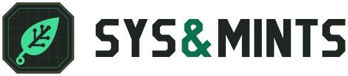
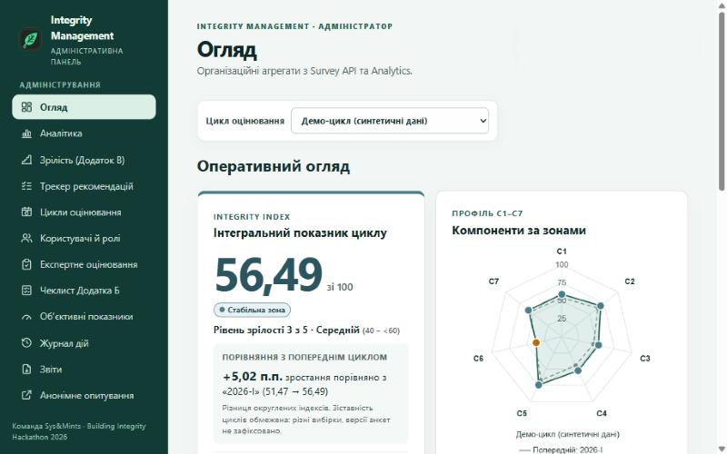

<picture>
  <source media="(prefers-color-scheme: dark)" srcset="docs/branding/sysmints-logo-dark.svg">
  
</picture>

# Integrity Management Dashboard

Команда «Sys&Mints» · Завдання 3. Integrity Management Dashboard

Цифрова система оцінювання стану й зрілості системи доброчесності. Вона охоплює весь цикл: анонімне опитування, обробку результатів, Integrity Index, рекомендації, контроль їх виконання і звіти. Оцінювання призначене для розвитку системи, а не для оцінки окремих посадових осіб.

## Проблема і користувач

Користувачі — керівник закладу й уповноважений з антикорупції, які відповідають за систему доброчесності, а також працівники, курсанти й викладачі, які її оцінюють. Сьогодні таке оцінювання проводять вручну: паперові анкети або Excel, ручне зведення й звіт забирають десятки годин на кожен цикл ([docs/time-savings.md](docs/time-savings.md)). Люди не довіряють анонімності й відповідають обережно, тому картина виходить неточною. Керівник отримує сотні відповідей, але не бачить, що саме покращувати і чи спрацювали минулі заходи. Без чесних даних і зрозумілих висновків система доброчесності розвивається навмання.

## Що робить рішення

- **Анонімне опитування** за одноразовими кодами: анкета не пов'язана ні з кодом, ні з акаунтом, а групи, менші за 5 людей, приховуються.
- **Integrity Index і Dashboard керівника**: індекс 0–100 за прозорою формулою, радар компонентів C1–C7, зони й рівні зрілості, динаміка між циклами.
- **Порівняльна аналітика**: розриви між категоріями респондентів і зіставлення самооцінки з об'єктивними показниками; непідтверджені факти позначаються «Потребує перевірки».
- **Рекомендації за явними правилами**: кожна пояснює, яке правило і які значення її спричинили.
- **Трекер рекомендацій**: прийнято → в роботі → виконано → перевірено, з відповідальною посадою, строком і перевіркою наступним циклом.
- **Ролі й кабінети**: адміністратор, відповідальний за коди доступу, користувач з особистими тестуваннями й результатами свого підрозділу. Вхід з 2FA, ролі адміністратора призначає лише власник сервера.
- **Звіти й журнал**: PDF/XLSX за закритими циклами, чернетки текстів від локальної мовної моделі з автоматичною звіркою чисел, журнал дій без змісту відповідей.



Модельний об'єкт демонстрації — вищий військовий навчальний заклад. Усі дані синтетичні. Анкети, критерії й індикатори можна адаптувати для інших органів сектору безпеки й оборони.

## Демонстрація

Відео до 3 хвилин: посилання буде додано до 23.11.2026

Крім локального Docker-стека, у команди є робочий сервер із синтетичними даними. Він доступний лише в приватній мережі Tailscale, з інтернету його не видно, тому адресу й запрошення ми навмисно не публікуємо. Щоб отримати доступ, зв'яжіться з **капітаном команди** через канал зв'язку, який надали організатори. Капітан надішле одноразове запрошення й адресу, а після перевірки, що ви член журі, призначить роль `admin` або `data_officer`. Як підключитися — у [docs/TAILSCALE_ACCESS.md](docs/TAILSCALE_ACCESS.md).

## Як запустити

**Потрібно встановити:** Git і Docker Desktop (Windows/macOS) або Docker Engine з плагіном Compose v2. Потрібні також доступ до Docker Hub і вільний порт 8080. Python і Node.js не потрібні. Команди наведено для PowerShell.

**1. Отримайте код і створіть `.env` з випадковим ключем:**

```powershell
git clone https://github.com/golem86/hacaton.git
cd hacaton
Copy-Item .env.example .env
$b = New-Object byte[] 32; [Security.Cryptography.RandomNumberGenerator]::Create().GetBytes($b)
$k = ([BitConverter]::ToString($b)).Replace('-', '').ToLowerInvariant()
(Get-Content .env) -replace '^V2_SECRET_KEY=.*$', "V2_SECRET_KEY=$k" | Set-Content .env
```

У `.env` обов'язкова лише змінна `V2_SECRET_KEY`. Змінні `V2_LM_*` і `LM_*` потрібні тільки для профілю з локальною моделлю. На Linux/macOS замість трьох останніх рядків: `sed -i.bak "s/^V2_SECRET_KEY=.*/V2_SECRET_KEY=$(openssl rand -hex 32)/" .env`.

**2. Зберіть і запустіть.** Перший запуск триває кілька хвилин, backend сам створює синтетичну БД:

```powershell
docker compose up --build
```

**3. Створіть локального адміністратора** в іншому терміналі. Пароль запитується двічі й не відображається:

```powershell
docker compose exec backend python -m app.v2_bootstrap_admin --name 'Local Demo Admin' --email 'demo-admin@example.test'
```

**4. Додайте демонстраційні цикли**, як на робочому сервері: 150 синтетичних анкет і цикл для екрана «Результати підрозділу».

```powershell
docker compose exec backend python -m app.demo_cycle --responses 150 --seed 2026 --confirm
docker compose exec backend python -m app.demo_cycle --no-small-groups --name "Демо: підрозділи" --confirm
```

**5. Увійдіть** на `http://127.0.0.1:8080/login`. Локальний стек не надсилає листів, тому код 2FA читається з тестової скриньки всередині контейнера:

```powershell
docker compose exec backend python -c "from app.v2_auth import latest_dev_mail; print(latest_dev_mail('demo-admin@example.test')['body'])"
```

Зупинка — `docker compose down` (дані зберігаються). Інші ролі, локальна мовна модель, очищення й усунення проблем — у [docs/DOCKER_DEMO.md](docs/DOCKER_DEMO.md). Запуск без Docker для розробки й перевірки — у [docs/LOCAL_DEV.md](docs/LOCAL_DEV.md).

Режим лише локальний: HTTP на `127.0.0.1`. Не відкривайте порт для інших комп'ютерів.

## Як влаштовано

- **Стек:**
  - frontend — React + TypeScript + Vite (`frontend/src`);
  - backend — Python + FastAPI + SQLAlchemy (`backend/app`);
  - дві SQLite-бази: `INTEGRITY_DB` (цикли, анкети, агрегати, трекер, аудит) і `V2_AUTH_DB` (користувачі, сесії, 2FA).
- **Компоненти:** браузер → Caddy (HTTPS, статичний frontend, проксі `/api/*` і `/v2/*`) → FastAPI → SQLite. Необов'язково — локальна мовна модель (llama.cpp), доступна лише через loopback. На сервері Windows кожен процес — окрема служба. Схема й потоки даних — у [docs/architecture.md](docs/architecture.md).
- **Основна логіка:** маршрути — `backend/app/routes/`, розрахунки — `backend/app/services/` (індекс, рекомендації, зрілість і звіти; без БД і мережі). Анонімність і приховування малих груп — `backend/app/anonymity.py`.
- **Правила, які роблять висновки** (п. 4 політики ШІ). Висновки рахують явні детерміновані правила, а не ШІ: однаковий вхід дає однаковий результат, і система працює без мовної моделі.
  - Integrity Index — `services/scoring.py`;
  - рекомендації — `services/recommendations.py` ([docs/methodology.md](docs/methodology.md));
  - зони й рівні зрілості — `services/maturity.py` ([docs/maturity-levels.md](docs/maturity-levels.md), [docs/maturity-annex-v.md](docs/maturity-annex-v.md)).

  Кожна рекомендація лише пропонується (`status=proposed`), рішення ухвалює людина. Локальна модель тільки пише чернетки текстів з агрегатів ([docs/ai.md](docs/ai.md)).
- **Методика:** авторська демонстраційна `team-results-demo-0.1` зі статусом «запропонована», а не офіційна. Ваги C1–C7, обґрунтування й обмеження — у [docs/methodology.md](docs/methodology.md).

## Документація

Обов'язкові матеріали завдання 3:

| Що вимагає завдання | Де |
|---|---|
| Робочий MVP | Цей репозиторій: запуск — розділ «Як запустити»; робочий сервер — розділ «Демонстрація» |
| Демонстрація проходження оцінювання | Відео (розділ «Демонстрація») і покроковий сценарій [docs/demo-scenario.md](docs/demo-scenario.md); синтетичні дані — [docs/DEMO_DATA.md](docs/DEMO_DATA.md) |
| Приклад розрахунку Integrity Index | [docs/methodology.md](docs/methodology.md), розділ 10 |
| Приклад Dashboard керівника | [docs/dashboard-example.md](docs/dashboard-example.md) |
| Приклади рекомендацій | [docs/methodology.md](docs/methodology.md), розділи 7 і 10 |
| Механізм захисту анонімності | [docs/anonymity.md](docs/anonymity.md) |
| Зіставлення самооцінки з об'єктивними показниками | [docs/objective-comparison-example.md](docs/objective-comparison-example.md) |
| Розрахунок економії часу | [docs/time-savings.md](docs/time-savings.md) |
| Карта інтеграції | [docs/integration-map.md](docs/integration-map.md) |
| Аналіз зловживань і запобіжників | [docs/abuse-analysis.md](docs/abuse-analysis.md) |
| Як ми використали ШІ | [docs/ai.md](docs/ai.md) |
| Концепція інтеграції з іншими рішеннями | [docs/integration-concept.md](docs/integration-concept.md) |

Інші документи:
- [docs/architecture.md](docs/architecture.md) — архітектура, компоненти й потоки даних.
- [docs/security.md](docs/security.md) — правила роботи з даними.
- [docs/maturity-levels.md](docs/maturity-levels.md) — правило зон і рівнів зрілості для кольорового кодування.
- [docs/maturity-annex-v.md](docs/maturity-annex-v.md) — модуль зрілості за Додатком В.
- [docs/API_CONTRACT.md](docs/API_CONTRACT.md) і [docs/V2_INTEGRATION_CONTRACT.md](docs/V2_INTEGRATION_CONTRACT.md) — контракти API.
- [docs/DOCKER_DEMO.md](docs/DOCKER_DEMO.md) — локальна демонстрація в Docker: деталі й усунення проблем.
- [docs/LOCAL_DEV.md](docs/LOCAL_DEV.md) — запуск без Docker і перевірки.
- [docs/demo-scenario.md](docs/demo-scenario.md) — покроковий сценарій: коди → анкета → закриття циклу → Огляд → трекер → звіт.
- [docs/ANALYTICS_DEMO.md](docs/ANALYTICS_DEMO.md) — сценарій показу аналітики.
- [docs/LOCAL_LM.md](docs/LOCAL_LM.md) — встановлення локальної мовної моделі.
- [docs/TAILSCALE_ACCESS.md](docs/TAILSCALE_ACCESS.md) — як журі підключитися до робочого сервера.
- [docs/BACKUP_RESTORE.md](docs/BACKUP_RESTORE.md) — резервні копії й відновлення робочого сервера.
- [docs/branding](docs/branding/README.md) — логотип команди й правила його використання.
- [docs/README.md](docs/README.md) — повний перелік документації. Робочі матеріали команди (`QUESTIONNAIRE_*`, `OFFICIAL_*`, `EXPERT_ROLE_*`, `V2_*`, `docs/reports/` тощо) — контракти, звіти й рішення, написані під час роботи; кожен файл має банер з датою стану.

## Що використали

- **Backend** (`backend/requirements.txt`): FastAPI 0.163.1, Starlette 1.10.0, Uvicorn 0.54.0, SQLAlchemy 2.1.8, Pydantic 2.14.3, ReportLab 5.1.0 (PDF), XlsxWriter 3.3.3 (XLSX), Pillow 13.0.0. Тести (`backend/requirements-dev.txt`): pytest, httpx, trustme.
- **Frontend** (`frontend/package.json`): React 19, React DOM 19, Chart.js 4.6.1. Збірка й тести: Vite 7, TypeScript 5.9, `@vitejs/plugin-react`, Playwright, node:test.
- **Шрифт PDF-звітів:** DejaVu Sans (`backend/app/static/report-font/`, ліцензія Bitstream Vera / DejaVu).
- **Swagger UI** 5.17.14 з пакета `swagger-ui-dist`, локально без CDN (`backend/app/static/swagger-ui/`, Apache-2.0).
- **Інфраструктура:** Caddy (HTTPS reverse proxy), WinSW 2.12.0 (служби Windows), Docker Compose, Tailscale (приватна мережа робочого сервера).
- **Моделі ШІ в продукті:** llama.cpp `llama-server` b12180 і модель `Qwen3-8B-Q4_K_M.gguf` (Hugging Face `Qwen/Qwen3-8B-GGUF`). Модель з відкритими вагами працює лише локально на сервері, без хмарних сервісів ([docs/LOCAL_LM.md](docs/LOCAL_LM.md)). Ліцензії: llama.cpp — MIT, Qwen3-8B — Apache-2.0. Тексти ліцензій у репозиторії не зберігаються, вони є на сторінках джерел.
- **Інструменти ШІ під час розробки:** ChatGPT, Codex, Claude Code. Для чого саме — у [docs/ai.md](docs/ai.md).
- **Методичні джерела:** Рекомендації НУОУ (2025), додатки Б і В (анкети й чек-лист адаптовано для синтетичної демонстрації).

## Ліцензія

MIT — див. [LICENSE](LICENSE).
