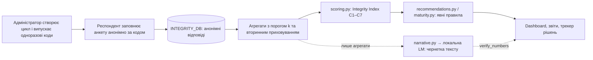

# Архітектура Integrity Management Dashboard

Документ описує фактичний стан репозиторію. Деталі маршрутів — у [API_CONTRACT.md](API_CONTRACT.md),
методики — у [methodology.md](methodology.md), анонімності — у [anonymity.md](anonymity.md).

## Компоненти

```
 Браузер (React/Vite SPA)
     │ HTTPS
     ▼
 Caddy  ── /assets/*, SPA ──► frontend/dist (статичні файли)
     │ /api/*, /v2/*, /docs, /openapi.json
     ▼
 FastAPI backend (backend/app, 127.0.0.1:8100 на сервері)
     ├── SQLite INTEGRITY_DB  (integrity schema 7: цикли, анкети, коди, агрегати, трекер, аудит, підрозділи користувачів V2)
     ├── SQLite V2_AUTH_DB    (auth schema 2: користувачі, сесії, 2FA, журнал змін ролей)
     └── HTTP (лише loopback) ──► llama-server + Qwen3-8B (необов'язково, 127.0.0.1:8200)
```

На сервері Windows кожен процес — окрема служба WinSW: backend, Caddy, LM
(шаблони `installer/windows-v2/integrity-v2-backend.xml.template`, `integrity-v2-caddy.xml.template`,
`integrity-v2-lm.xml.template`).

## Backend (`backend/app`)

- Точка входу — `main.py`: підключає роутери, ліміт розміру тіла запиту (`request_limits.py`) і Swagger
  (`api_docs.py`, `/docs` і `/openapi.json` лише для сесії admin з 2FA).
- Маршрути `routes/`:
  - `assessments.py` — цикли оцінювання, одноразові коди доступу, прийом анкет (`/api/assessments/...`);
  - `results.py` — агреговані результати циклу з порогом k;
  - `analytics.py` — Integrity Index, порівняння, рекомендації (синтетична демонстрація);
  - `tracker.py` — трекер рішень щодо рекомендацій;
  - `annex_v.py` — зрілість за Додатком В: анкети, чек-лист, об'єктивні показники;
  - `v2_auth.py`, `v2_user.py`, `v2_admin.py`, `v2_admin_users.py` — V2: сесії, 2FA, CSRF, ролі, кабінети;
  - у `v2_user.py` також `GET /v2/user/unit-results` — узагальнені бали C1–C7 власного підрозділу користувача
    за закритий цикл (підрозділ визначає лише сервер, клієнт його не передає);
  - `v2_narrative.py` — чернетки текстів локальною LM, лише для admin (підключається в `v2_admin.py`).
- Сервіси `services/` — розрахунки й правила; без БД і мережі всі, крім `unit_results.py` (читає БД) і
  `narrative.py` (читає БД і звертається до локальної LM):
  - `scoring.py` — Integrity Index (версія методики, ваги C1–C7, правило пропусків);
  - `recommendations.py` — детерміновані пропозиції за правилами («No acceptance or index changes»);
  - `maturity.py`, `maturity_report.py` — рівні зрілості за Додатком В;
  - `analytics.py` — порівняння лише опублікованих агрегатів;
  - `reporting.py` — експорт звітів із уже прихованих агрегатів;
  - `tracker.py` — переходи статусів рекомендацій;
  - `narrative.py` — клієнт локальної LM, звірка чисел `verify_numbers`, фонова черга завдань;
  - `unit_results.py` — результати підрозділу для користувача V2: підрозділ лише з таблиці `user_units`;
    бали показуються, лише якщо в підрозділі щонайменше k анкет і кожна непорожня клітинка
    «категорія × підрозділ» циклу має щонайменше k анкет; кількість анкет округлюється вниз до кратного 5.
- Анонімність: `anonymity.py` — приховування груп, менших за k, і вторинне приховування.
- Журнал дій: `audit.py` — дозволений перелік дій без вмісту анонімних відповідей.
- Дані:
  - `models.py`, `database.py`, `migrations.py` — SQLite `INTEGRITY_DB`, `SCHEMA_VERSION = 7`
    (версія 7 додала таблицю `user_units` — належність користувача V2 до підрозділу);
  - `v2_auth.py` — окрема SQLite `V2_AUTH_DB`, `AUTH_SCHEMA_VERSION = 2`.

  У release автоміграцію вимкнено: сервер лише перевіряє схему (`migrations.check_schema`,
  `v2_auth.check_auth_schema`).
- Налаштування: `settings.py` (змінні середовища; у release `V2_LM_URL` — лише loopback).
- Консольні команди власника сервера: `v2_bootstrap_admin.py`, `v2_role_cli.py` (ролі), `v2_unit_cli.py`
  (призначення й зняття підрозділу користувача в `user_units`, подія аудиту `user.unit_change`), `seed.py` / `seed_annex_v.py` (синтетичні дані).

## Frontend (`frontend/src`)

React + TypeScript + Vite.

- `v2/` — оболонка V2: особистий модуль, аудит, трекер, звіти, користувачі, панель
  `NarrativePanel.tsx` (чернетки ШІ), `UnitResults.tsx` (екран «Результати підрозділу»).
- `dashboard/` — аналітичний dashboard: огляд, бали компонентів, порівняння категорій, тренди, зрілість,
  приховування малих груп (`suppression.tsx`).
- `official/` — офіційні анкети та каталог (`catalog.ts`, `catalog-v2.ts`, `validation.ts`).
- `pages/Survey.tsx` — заповнення анкети.
- `api/` — клієнти запитів до `/api/*` і `/v2/*`.

## Потік даних



Висновки (індекс, рекомендації, рівні зрілості) обчислюють явні правила Python у `services/scoring.py`,
`services/recommendations.py` і `services/maturity.py`. ШІ нічого не вирішує:
- рекомендації — пропозиції, які приймає людина в трекері;
- локальна LM лише пише чернетку тексту з уже агрегованих фактів;
- кожне число чернетки звіряється з фактами (`verify_numbers`).

## Розгортання

- **Сервер Windows.** Інсталятор і службові скрипти — у `installer/windows-v2/`. Caddy
  (`installer/windows-v2/deploy/Caddyfile`) завершує TLS, віддає `frontend/dist` і проксує `/api/*`, `/v2/*`, `/docs`
  на backend `127.0.0.1:8100`. Консольні обгортки — `installer/windows-v2/ops/` (наприклад, `Set-V2UserRole.ps1`).
- **Локальна LM.** llama.cpp `llama-server` з моделлю `Qwen3-8B-Q4_K_M.gguf`, служба `integrity-v2-lm`; backend
  звертається до неї через `V2_LM_URL`. Без `V2_LM_URL` функцію чернеток вимкнено (503). Деталі — у
  [LOCAL_LM.md](LOCAL_LM.md).
- **Docker-демо.** `compose.yaml` має служби `backend`, `frontend` і `lm` (профіль `lm`, внутрішня мережа `lm_net`
  без виходу в інтернет). Демо лише локальне, на синтетичних даних — див. [DOCKER_DEMO.md](DOCKER_DEMO.md).
