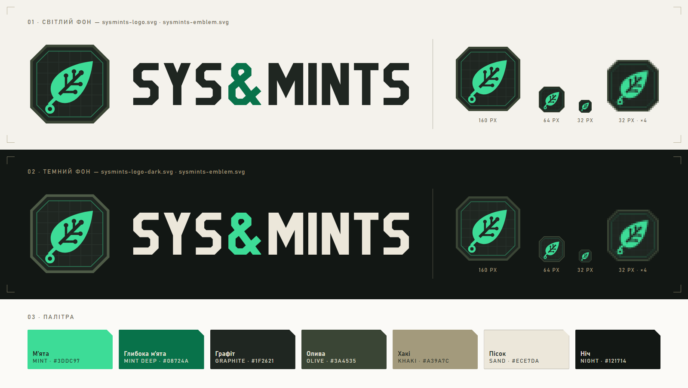

# Sys&Mints — логотип



## Концепція

Емблема — восьмикутна тактична пластина з фасками 45°, схожа на шильдик на техніці. На ній — листок м'яти, зібраний із друкованих доріжок: центральна жилка — це шина, бічні жилки закінчуються контактними майданчиками (via), а черешок веде до вузла-індикатора.
**Sys** — це системи та інженерія: пластина, тактична сітка, HUD-рамка. **Mints** — це свіжість, прозорість і доброчесність: листок і м'ятне світіння, яке читається і як рослина, і як зелений сигнал «система в нормі» на екрані радара.
Контур листка суцільний, без жодного розриву. Так доброчесність постає інженерною цілісністю (integrity): система без «витоків», у бездоганному стані — англійською *mint condition*.

Логотип — оригінальна робота. У ньому немає державної символіки, військових знаків розрізнення, зброї чи чужих логотипів.

## Напис

Напис «SYS&MINTS» набрано великими літерами: це мова технічного маркування й трафаретів, а однакова висота літер дає щільний, рівний блок. Амперсанд у м'ятному кольорі — шарнір між двома словами, Sys і Mints. Він накреслений як одна безперервна «доріжка» з двома перетинами, тож легко читається навіть у дрібному розмірі.

## Шрифт

Літери напису не належать жодному шрифту. Це власні вузькі накреслення з фасками 45°, побудовані з контурів (`<path>`), тож SVG однаково відображається без жодних встановлених шрифтів.

Для слайдів і відео радимо OFL-шрифти з повною кирилицею (є на Google Fonts): **Fira Sans Condensed** для заголовків і тексту, **IBM Plex Mono** для цифр, підписів і HUD-міток.

## Файли

| Файл | Де використовувати |
|---|---|
| `sysmints-logo.svg` / `.png` | основний логотип для світлого фону: README, документація, світлі слайди |
| `sysmints-logo-dark.svg` / `.png` | темний фон: темні слайди, демо-відео, темна тема GitHub |
| `sysmints-emblem.svg` / `.png` | аватар, favicon, іконка, водяний знак у кутку відео; будь-де, куди не вміщується напис |
| `sysmints-preview.png` | огляд усіх варіантів для команди й журі; не використовувати як логотип |

SVG використовуйте скрізь, де можна: веб, PowerPoint, Keynote, Figma. PNG (прозорий фон; логотипи 1600 px завширшки, емблема 512×512) — для Google Slides, відеоредакторів і соцмереж.

Щоб логотип у README перемикався разом із темою GitHub:

```html
<picture>
  <source media="(prefers-color-scheme: dark)" srcset="docs/branding/sysmints-logo-dark.svg">
  
</picture>
```

## Палітра

| Колір | HEX | Роль |
|---|---|---|
| М'ята (Mint) | `#3DDC97` | сигнатурний акцент: листок, «&» на темному фоні, індикатори |
| Глибока м'ята (Mint Deep) | `#08724A` | «&» і акценти на світлому фоні |
| Графіт (Graphite) | `#1F2621` | пластина емблеми, напис на світлому фоні |
| Олива (Olive) | `#3A4535` | рамка пластини, вторинний темний |
| Хакі (Khaki) | `#A39A7C` | тонкі технічні лінії, підписи на темному фоні |
| Пісок (Sand) | `#ECE7DA` | напис на темному фоні, світлі фони |
| Ніч (Night) | `#121714` | темний фон |

Службові відтінки емблеми: `#4E5B47` — рамка в темній версії, `#2D7A57` — HUD-контур, `#29322C` — сітка.

Контраст напису за WCAG:
- графіт на білому — 15,5:1;
- глибока м'ята на білому — 6,0:1, на «Піску» — 4,8:1;
- пісок на «Ночі» — 14,7:1;
- м'ята на «Ночі» — 10,3:1.

Яскрава м'ята на білому дає лише 1,8:1, тому на світлому фоні «&» завжди в глибокій м'яті.

## Охоронне поле і мінімальний розмір

- Модуль **X = ¼ висоти емблеми** (у PNG завширшки 1600 px це 88 px). Навколо логотипа й окремої емблеми залишайте щонайменше X вільного простору.
- Логотип із написом — щонайменше **140 px** завширшки на екрані або **30 мм** у друці. Якщо місця менше, використовуйте лише емблему.
- Емблема — від **32 px** (аватар, вкладка браузера). Гранична межа для favicon — **16 px**. Сітка й HUD-контур на малих розмірах зникають навмисно.
- Не розтягуйте логотип, не перефарбовуйте його й не додавайте тіней чи обведень. Не ставте світлу версію на темний фон і навпаки.
