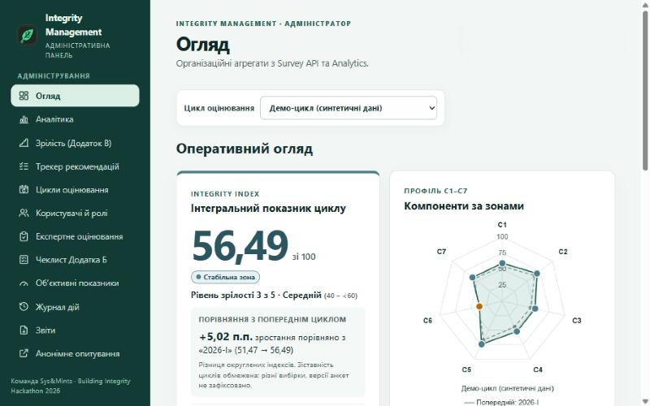

# Приклад Dashboard керівника

Головний екран адміністратора — «Огляд». Знімок зроблено на робочому сервері для закритого циклу «Демо-цикл (синтетичні дані)»: 150 анкет, участь 83,3 %. Дані повністю синтетичні.

## Що на екрані

| Блок | Що показує | Правило |
|---|---|---|
| Integrity Index | Число 0–100, зона, рівень зрілості, зміна до попереднього закритого циклу | Зважена сума C1–C7 ([methodology.md](methodology.md)); зони й рівні — [maturity-levels.md](maturity-levels.md) |
| Радар C1–C7 | Бали семи компонентів системи доброчесності | Середнє відповідей компонента, шкала 1–5 → 0–100 |
| Сильні сторони й проблемні зони | Компоненти з найвищими й найнижчими балами | Сильна сторона ≥ 75, проблемна зона < 50 |
| Перехід до компонента | Картка компонента: бал, категорії, динаміка | Ті самі агрегати, без окремих анкет |

Кольорова позначка ніколи не єдина: поруч завжди є текстова мітка. Прихована мала група показується як «Немає даних», без кольору.

## Бали демо-циклу

Integrity Index — **56,49** зі 100: стабільна зона, рівень зрілості 3 «Середній», +5,02 п.п. до циклу 2026-I (51,47).

| Компонент | Загалом | Курсанти | НПП |
|---|---:|---:|---:|
| C1 Лідерство й тон керівництва | 59,3 | 55,9 | 65,1 |
| C2 Антикорупційна політика і процедури | 69,3 | 66,0 | 75,6 |
| C3 Управління корупційними ризиками | 52,4 | 50,6 | 54,4 |
| C4 Доброчесність освітнього процесу | 52,5 | 45,8 | 64,5 |
| C5 Навчання і комунікація | 74,5 | 73,1 | 77,0 |
| C6 Повідомлення про порушення | 36,5 | 31,9 | 43,0 |
| C7 Моніторинг і контроль | 59,2 | 58,9 | 59,0 |

Керівництво (4 анкети) і персонал (3 анкети) приховані порогом анонімності k = 5 ([anonymity.md](anonymity.md)).

Як керівник читає цей екран:
- найслабший компонент — C6 «Повідомлення про порушення» (36,5, проблемна зона). Правило `LOW_SCORE_LT_50_V1` пропонує рекомендацію;
- найбільший розрив між категоріями — у C4: курсанти оцінюють на 18,7 бала нижче, ніж НПП. Це менше за поріг правила розриву (25), тому окремої рекомендації немає, але розрив видно на «Аналітиці»;
- рекомендації переходять у трекер: людина приймає їх, призначає відповідальну посаду й строк, а виконання перевіряється наступним циклом.

Як відтворити ці дані локально — [DEMO_DATA.md](DEMO_DATA.md).
