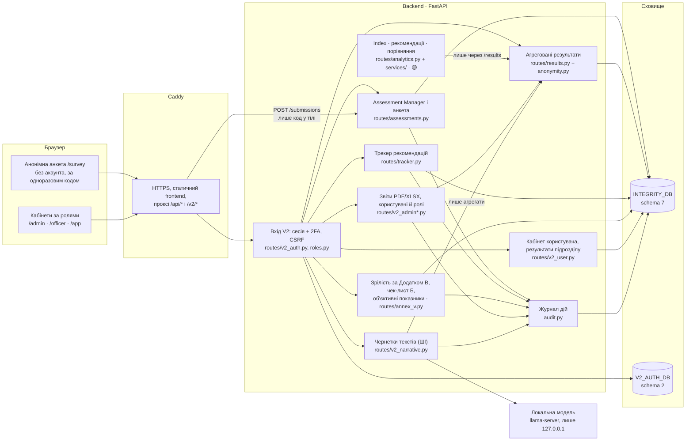
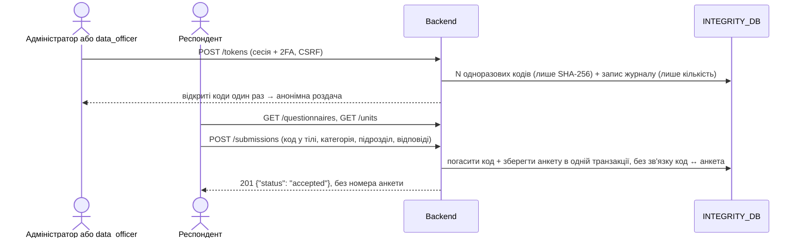
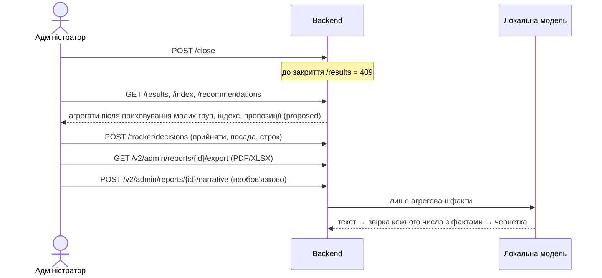

# Карта інтеграції Integrity Management Dashboard

Пункт здачі 9. Документ показує, з яких компонентів складається система, як між ними рухаються дані, які API-маршрути працюють і як систему можна підключити як модуль до наявних відомчих інформаційних систем.

**Стан — зафіксований код `6629c74` (20.11.2026), він же працює на робочому сервері.** Схеми БД: integrity 7, auth 2. Backend-тести: 927 (`.github/workflows/v2-ci.yml`). Усі дані синтетичні. Методика Integrity Index демонстраційна й не має статусу офіційно затвердженої.

Позначення статусу:

| Позначка | Значення |
| --- | --- |
| ✅ Реалізовано | код у `main`, покритий тестами, працює на робочому сервері |
| 🟡 Демо за прапорцем | обчислювальні маршрути аналітики працюють лише з `INTEGRITY_ANALYTICS_DEMO=1` на синтетичній БД; на робочому сервері прапорець увімкнено, бо там лише синтетичні дані |
| ⚪ Не реалізовано | описано як напрям розвитку, коду немає |

## 1. Схема компонентів

На сервері Windows Caddy, backend і локальна модель працюють як окремі служби. Доступ до сервера — лише через приватну мережу Tailscale ([TAILSCALE_ACCESS.md](TAILSCALE_ACCESS.md)). Детальна архітектура — у [architecture.md](architecture.md).

## 2. Компоненти і стан

| Компонент | Де в коді | Стан |
| --- | --- | --- |
| Анонімна анкета (код, категорія, підрозділ, відповіді) | `frontend/src/pages/Survey.tsx`, `routes/assessments.py` → `submit_answers` | ✅ |
| Assessment Manager: створення й активація циклу, коди доступу, участь, закриття | `routes/assessments.py`, `frontend/src/components/AssessmentManager.tsx` | ✅ |
| Вхід і ролі: реєстрація, сесія, 2FA поштою, CSRF, ролі `admin`, `data_officer`, `user` | `routes/v2_auth.py`, `roles.py`, `v2_auth.py` | ✅ |
| Призначення ролей `admin` і `data_officer` | лише консоль власника сервера: `app.v2_role_cli` | ✅ |
| Захист малих груп (первинне й вторинне приховування) | `anonymity.py`, [anonymity.md](anonymity.md) | ✅ |
| Агреговані результати | `routes/results.py` | ✅ |
| Executive Dashboard: «Огляд», «Аналітика» | `frontend/src/dashboard/` | ✅ |
| Integrity Index, рекомендації, порівняння циклів | `routes/analytics.py`, `services/scoring.py`, `recommendations.py`, `analytics.py` | 🟡 |
| Трекер рекомендацій: рішення, відповідальна посада, строк, статуси | `routes/tracker.py`, `services/tracker.py` | ✅ |
| Зрілість за Додатком В: анкети, експертні оцінки, чек-лист Додатка Б, показники з підтвердженням | `routes/annex_v.py`, `services/maturity.py`, [maturity-annex-v.md](maturity-annex-v.md) | ✅ |
| Звіти PDF/XLSX за циклом і звіт зрілості | `routes/v2_admin.py`, `services/reporting.py` | ✅ |
| Кабінет користувача: особисті тестування, статистика, «Результати підрозділу» | `routes/v2_user.py`, `services/unit_results.py` | ✅ |
| Чернетки текстів звіту локальною моделлю | `routes/v2_narrative.py`, `services/narrative.py`, [LOCAL_LM.md](LOCAL_LM.md) | ✅ |
| Журнал дій без змісту анонімних відповідей | `audit.py` | ✅ |
| Міграції схеми з резервною копією | `migrations.py`, [DATABASE_UPGRADE.md](DATABASE_UPGRADE.md) | ✅ |

## 3. API-маршрути

Захищені маршрути вимагають перевіреної сесії V2: cookie після входу з 2FA. Для запитів, що змінюють дані, потрібен ще й заголовок `X-CSRF-Token`. Ролі визначає лише сервер за сесією. Заголовок `X-Role` у release не діє ([API_CONTRACT.md](API_CONTRACT.md)).

| Група | Маршрути | Хто має доступ | Стан |
| --- | --- | --- | --- |
| Службове | `GET /api/health` | усі | ✅ |
| Довідники й анкета | `GET /api/assessments`, `/api/assessments/{id}`, `/questionnaires`, `GET /api/units` | усі | ✅ |
| Подання анкети | `POST /api/assessments/{id}/submissions` | без акаунта, за одноразовим кодом у тілі запиту | ✅ |
| Цикли | `POST /api/assessments`, `/{id}/activate`, `/{id}/close` | admin | ✅ |
| Коди й участь | `POST /api/assessments/{id}/tokens`, `GET /{id}/participation` | admin, data_officer | ✅ |
| Результати | `GET /api/assessments/{id}/results` | admin | ✅ |
| Аналітика | `GET /api/index-methodologies/{version}`, `/{id}/index`, `/{id}/recommendations`, `GET /api/analytics/comparisons` | admin | 🟡 |
| Трекер | `GET /api/assessments/{id}/tracker`, `POST …/tracker/decisions`, `POST /api/tracker/{action_id}/transition` | admin | ✅ |
| Зрілість, чек-лист, показники | `…/annex-v/*`, `…/checklist*`, `…/objective-indicators*`, `…/maturity` | admin; data_officer вносить чек-лист і показники, підтверджує інший користувач | ✅ |
| Журнал дій | `GET /api/audit-events` | admin | ✅ |
| Вхід | `/v2/auth/*`: реєстрація, вхід, 2FA, скидання пароля, вихід | усі | ✅ |
| Адміністрування | `/v2/admin/reports/*`, `/v2/admin/users*`, `/v2/admin/role-changes`, `/v2/admin/lm/*` | admin | ✅ |
| Кабінет користувача | `/v2/user/*` | user | ✅ |

Точні формати запитів, відповідей і помилок — у [API_CONTRACT.md](API_CONTRACT.md). OpenAPI-опис (`/docs`, `/openapi.json`) доступний адміністратору після входу з 2FA.

## 4. Потоки даних

### 4.1 Проходження оцінювання

### 4.2 Від закриття циклу до рішень

Ключове правило: **аналітика, звіти й мовна модель не мають доступу до окремих анкет**. Вони працюють лише з результатами `/results`, тобто вже після приховування малих груп.

### 4.3 Журнал дій

У журнал записуються:
- видача кодів і керування циклами;
- рішення трекера;
- чек-лист і об'єктивні показники;
- вхід, вихід і зміни ролей;
- експорт звіту зрілості й чернетки ШІ. Записується роль і id користувача, без email, кодів і тексту. Подання анкет, відповіді, категорії й підрозділи респондентів **не журналюються** (allowlist полів у `audit.py`).

## 5. Залежності між компонентами

| Компонент | Залежить від | Що буде, якщо залежність зміниться |
| --- | --- | --- |
| Анкета | `/questionnaires`, `/units`, `/submissions` | зміна формату питань потребує оновлення форми |
| Dashboard | `/assessments`, `/results`, аналітика | зміна структури `results` потребує оновлення `frontend/src/dashboard/types.ts` |
| Аналітика, звіти, чернетки ШІ | `assessment_results()` з `routes/results.py` | будь-яке нове агрегування має проходити через ту саму функцію приховування |
| Integrity Index | ваги з таблиці `components` | зміна ваг змінює індекс; методика версіонується (`team-results-demo-0.1`) |
| Захищені маршрути | сесія V2 (`V2_AUTH_DB`) | недоступна БД автентифікації → 503 замість доступу |
| Усі модулі | `migrations.py` | нова схема → нова версія `user_version` і тест міграції; у release автоміграцію вимкнено |

## 6. Що не реалізовано

| Можливість | Що потрібно |
| --- | --- |
| Затверджена методика Integrity Index | погодження компонентів, ваг і порогів робочою групою; тоді прапорець демо-аналітики не потрібен |
| Вхід через відомчу систему ідентифікації | підключення SSO замість власних облікових записів (правила доступу не змінюються) |
| Імпорт підрозділів і чисельності з кадрових систем | зараз довідник `units` заповнює seed |
| Введення 7 об'єктивних показників Integrity Index через UI | зараз їх вносить seed; для зрілості за Додатком В введення з підтвердженням уже є |
| Evidence Repository (сховище підтвердних документів) | окреме сховище й правила доступу |
| PostgreSQL замість SQLite | розділ 7 |

## 7. Інтеграція з наявними інформаційними системами

Умова вимагає, щоб рішення могло працювати **як модуль** наявної системи, а не лише окремо. Архітектура до цього готова:

- **REST API з OpenAPI-описом** (`/docs`, `/openapi.json`): будь-яка система може викликати маршрути без нашого інтерфейсу.
- **Немає залежності від хмарних сервісів.** Python, FastAPI, SQLite і локальна мовна модель працюють у закритому відомчому контурі. Робочий сервер уже розгорнуто так: Windows-служби, доступ лише через приватну мережу.
- **Сховище можна замінити, але не одним рядком.** Моделі описані через SQLAlchemy, тому таблиці й запити здебільшого не залежать від СУБД. Перехід на PostgreSQL, крім зміни рядка підключення в `backend/app/database.py`, потребує:
  - переписати міграції `backend/app/migrations.py`, бо вони використовують `PRAGMA user_version`, `foreign_key_check`, `integrity_check` і SQLite backup API (наприклад, на Alembic);
  - замінити специфічне для SQLite вмикання зовнішніх ключів у `database.py`;
  - повністю прогнати тести й тестову міграцію на PostgreSQL.
- **Межі модулів чіткі:** кожен модуль — окремий роутер FastAPI, його можна вимкнути або підключити до іншого застосунку.

Типові точки інтеграції (конкретні системи визначає замовник):

| Тип відомчої системи | Що передає або отримує | Точка інтеграції в нас | Стан |
| --- | --- | --- | --- |
| Система ідентифікації та єдиного входу | особа користувача | замінює вхід у `routes/v2_auth.py`; ролі лишаються за сервером | ⚪ |
| Кадрові та організаційні довідники | перелік підрозділів, планова кількість учасників | таблиця `units`, кількість кодів | ⚪ (зараз з seed) |
| Системи обліку навчання | охоплення персоналу навчанням | об'єктивні показники | ✅ для Додатка В (введення з підтвердженням) / ⚪ для Integrity Index |
| Системи планування антикорупційних заходів | виконання плану заходів | об'єктивні показники, трекер рекомендацій | ✅ (вручну) / ⚪ (автоматичний обмін) |
| Система електронного документообігу | звіти керівництву, підтвердні документи | звіти PDF/XLSX; Evidence Repository | ✅ / ⚪ |
| Системи внутрішнього контролю та аудиту | журнал адміністративних дій | `GET /api/audit-events` | ✅ (читання) |
| Аналітичні системи керівництва | агреговані результати й індекс | `/results`, `/index` | ✅ / 🟡 |

Жодна точка інтеграції не передає назовні окремі анкети чи відповіді: лише агрегати після приховування малих груп.

## 8. Як запустити все разом

Рекомендований спосіб — Docker, розділ «Як запустити» в [README](../README.md). Запуск без Docker і перевірки — [LOCAL_DEV.md](LOCAL_DEV.md). Встановлення на сервер Windows — `installer/windows-v2/docs/`.

Пов'язані документи: [architecture.md](architecture.md), [API_CONTRACT.md](API_CONTRACT.md), [anonymity.md](anonymity.md), [abuse-analysis.md](abuse-analysis.md), [integration-concept.md](integration-concept.md).
