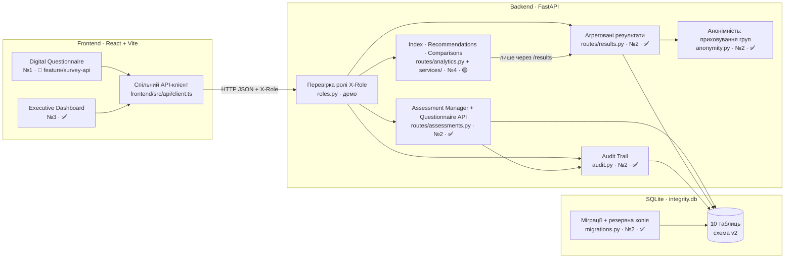
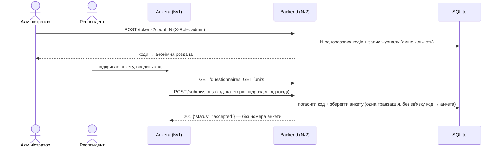
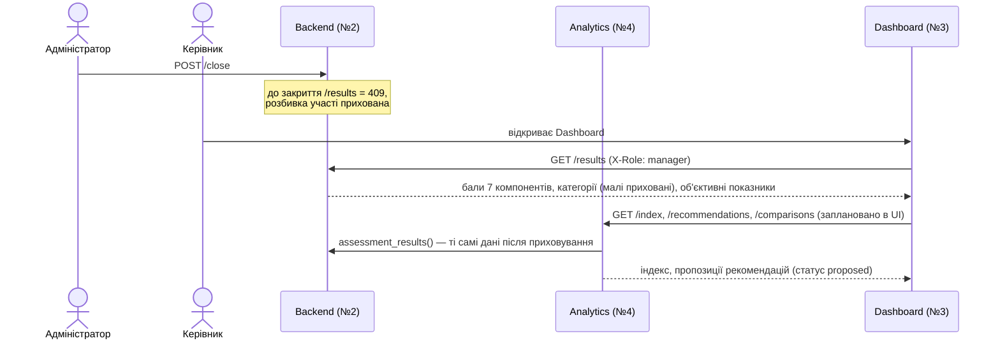

# Карта інтеграції Integrity Management Dashboard

Пункт здачі 9. Документ показує, з яких компонентів складається система, як між ними рухаються дані, які API-маршрути вже працюють і як систему можна підключити як модуль до наявних відомчих інформаційних систем.

**Стан на 17.11.2026, гілка `feature/integration` (`cc66d1b`), backend-тести: 122 passed.** Усі дані синтетичні. Методика з 7 компонентів демонстраційна і не має статусу офіційно затвердженої.

Позначення статусу:

| Позначка | Значення |
| --- | --- |
| ✅ Реалізовано | код у `feature/integration`, покритий тестами |
| 🟡 Демо за прапорцем | працює лише з `INTEGRITY_ANALYTICS_DEMO=1` на синтетичній БД |
| 🔵 У гілці | код є в окремій гілці, ще не злитий |
| ⚪ Заплановано | описано в контракті, коду немає |

## 1. Схема компонентів



Інтеграційний рівень і QA (№5): гілка `feature/integration`, рев'ю PR, `docs/API_CONTRACT.md`, спільний демо-сервер.

## 2. Компоненти, власники і стан

| Компонент | Власник | Де в коді | Стан |
| --- | --- | --- | --- |
| Digital Questionnaire (форма анкети, вибір категорії й підрозділу, надсилання) | №1 | `frontend/src/pages/Survey.tsx`, `components/SurveyForm.tsx` у гілці `feature/survey-api` | 🔵 у гілці, PR ще немає |
| Assessment Manager API (цикли, коди доступу, закриття, довідник підрозділів) | №2 | `backend/app/routes/assessments.py` | ✅ |
| Анонімне надсилання анкет | №2 | `routes/assessments.py` → `submit_answers` | ✅ |
| База даних SQLite, 10 таблиць | №2 | `backend/app/models.py`, `database.py` | ✅ |
| Міграції схеми 0 → 1 → 2 з резервною копією | №2 | `backend/app/migrations.py`, `docs/DATABASE_UPGRADE.md` | ✅ |
| Захист малих груп (первинне й вторинне приховування) | №2 | `backend/app/anonymity.py`, `docs/anonymity.md` | ✅ |
| Агреговані результати для аналітики й Dashboard | №2 | `backend/app/routes/results.py` | ✅ |
| Audit Trail | №2 | `backend/app/audit.py` | ✅ |
| Executive Dashboard (бали компонентів, порівняння категорій, об'єктивні показники) | №3 | `frontend/src/dashboard/`, `docs/DASHBOARD_PLAN.md` | ✅ |
| Integrity Index Engine, Comparative Analytics, Recommendations Engine | №4 | `backend/app/routes/analytics.py`, `backend/app/services/` | 🟡 демо за прапорцем |
| Recommendations Tracker (доменна логіка переходів статусів) | №4 | `backend/app/services/tracker.py` | 🟡 лише функція, без HTTP і зберігання |
| Інтеграція, QA, контракт API, демо-сервер | №5 | `feature/integration`, `docs/API_CONTRACT.md` | ✅ |

## 3. API-маршрути

Усі маршрути, крім `/api/health`, вимагають заголовок `X-Role`. **`X-Role` — демонстраційний механізм, а не автентифікація** (див. розділ 7 і `docs/abuse-analysis.md`).

| Метод і шлях | Ролі | Хто використовує | Стан |
| --- | --- | --- | --- |
| `GET /api/health` | без ролі | QA, демо-сервер | ✅ |
| `GET /api/assessments` | усі | Dashboard, анкета | ✅ |
| `GET /api/assessments/{id}` | усі | Dashboard | ✅ |
| `GET /api/assessments/{id}/questionnaires` | усі | анкета (№1) | ✅ |
| `GET /api/units` | усі | анкета (№1) | ✅ |
| `POST /api/assessments/{id}/submissions` | respondent | анкета (№1) | ✅ |
| `POST /api/assessments/{id}/tokens` | admin | адміністратор оцінювання | ✅ |
| `POST /api/assessments/{id}/close` | admin | адміністратор оцінювання | ✅ |
| `GET /api/assessments/{id}/participation` | admin, manager, anticorruption, auditor | контроль проходження | ✅ |
| `GET /api/assessments/{id}/results` | admin, manager, anticorruption, auditor | Dashboard (№3), аналітика (№4) | ✅ |
| `GET /api/audit-events` | admin, auditor | аудитор | ✅ |
| `GET /api/index-methodologies/{version}` | admin, manager, anticorruption, auditor | прозорість методики | 🟡 |
| `GET /api/assessments/{id}/index` | те саме | Dashboard (ще не підключено в UI) | 🟡 |
| `GET /api/assessments/{id}/recommendations` | те саме | Dashboard (ще не підключено в UI) | 🟡 |
| `GET /api/analytics/comparisons` | те саме | Dashboard (ще не підключено в UI) | 🟡 |
| `POST /api/assessments` | — | створення циклу | ⚪ |
| `GET /api/recommendations`, `PATCH /api/recommendations/{id}` | — | Recommendations Tracker | ⚪ |
| `GET /api/assessments/{id}/dashboard` | — | зведення для Dashboard | ⚪ |
| `GET /api/assessments/{id}/reports`, `GET /api/reports/{id}/export` | — | звіти й експорт | ⚪ |

Точні формати запитів, відповідей і помилок наведено в `docs/API_CONTRACT.md`.

## 4. Потоки даних

### 4.1 Проходження оцінювання



### 4.2 Від закриття циклу до Dashboard



Ключове правило: **аналітика не має власного доступу до анкет**. Індекс, порівняння й рекомендації рахуються лише з результатів `/results`, тобто вже після приховування малих груп.

### 4.3 Журнал дій

Видача кодів і закриття циклу записуються в `audit_events` в одній транзакції з дією. Подання анкет, коди, відповіді, категорії й підрозділи **не журналюються** (allowlist полів у `audit.py`).

## 5. Залежності між компонентами

| Компонент | Залежить від | Що буде, якщо залежність зміниться |
| --- | --- | --- |
| Анкета (№1) | `/questionnaires`, `/units`, `/submissions`, спільний API-клієнт | зміна формату питань (перехід зі `scale` на `options`) потребує оновлення форми |
| Dashboard (№3) | `/assessments`, `/results` | зміна структури `results` потребує оновлення `frontend/src/dashboard/types.ts` |
| Analytics (№4) | `assessment_results()` з `routes/results.py`, ваги з таблиці `components` | зміна компонентів чи ваг змінює індекс; методика версіонується (`team-results-demo-0.1`) |
| `/results` (№2) | `anonymity.py`, таблиці відповідей і об'єктивних показників | будь-яке нове агрегування має проходити через ту саму функцію приховування |
| Усі backend-модулі | `migrations.py` | нова схема → нова версія `user_version` і тест міграції |

## 6. Що ще не реалізовано

| Можливість | Що потрібно | Хто |
| --- | --- | --- |
| Анкета в `feature/integration` | злити `feature/survey-api` після рев'ю | №1, №5 |
| Індекс, рекомендації, порівняння в Dashboard | підключити маршрути №4 в UI | №3, №4 |
| Recommendations Tracker | зберігання, `PATCH`, історія, відповідальний і строк від автентифікованої особи | №2, №4 |
| Створення циклів через API | `POST /api/assessments` | №2 |
| Звіти й експорт (PDF / XLSX) | Reporting Module | не призначено |
| Офіційні питання додатків Б і В | нова версія каталогу й методики, міграція схеми | наступна версія (рішення №5) |
| Експертне оцінювання з доказами | окреме джерело, рубрика, сховище підтвердних матеріалів | наступна версія |
| Справжня автентифікація | заміна `X-Role` входом через відомчу систему | наступна версія |

## 7. Інтеграція з наявними інформаційними системами

Умова вимагає, щоб рішення могло працювати **як модуль** наявної системи, а не лише окремо. Архітектура до цього готова:

- **REST API з OpenAPI-описом** (`/docs`, `/openapi.json`): будь-яка система може викликати маршрути без нашого інтерфейсу;
- **немає залежності від хмарних сервісів**: Python, FastAPI, SQLite, усе працює в закритому відомчому контурі;
- **сховище замінне**: SQLAlchemy дозволяє перейти з SQLite на PostgreSQL зміною рядка підключення в `backend/app/database.py`;
- **межі модулів чіткі**: кожен модуль — окремий роутер FastAPI, його можна вимкнути або підключити до іншого застосунку.

Типові точки інтеграції (конкретні системи визначає замовник):

| Тип відомчої системи | Що передає або отримує | Точка інтеграції в нас | Стан |
| --- | --- | --- | --- |
| Система ідентифікації та єдиного входу | роль користувача | замінює `X-Role` у `roles.py` (правила доступу не змінюються) | ⚪ |
| Кадрові та організаційні довідники | перелік підрозділів, планова кількість учасників | таблиця `units`, кількість кодів (`cohort_size`) | ⚪ (зараз з seed) |
| Системи обліку навчання | охоплення персоналу навчанням | `objective_indicators` | ⚪ (зараз з seed) |
| Системи планування антикорупційних заходів | виконання плану заходів | `objective_indicators`, Recommendations Tracker | ⚪ |
| Система електронного документообігу | підтвердні документи, звіти керівництву | Evidence Repository, Reporting Module | ⚪ |
| Системи внутрішнього контролю та аудиту | журнал адміністративних дій | `GET /api/audit-events` | ✅ (читання) |
| Аналітичні системи керівництва | агреговані результати й індекс | `/results`, `/index` | ✅ / 🟡 |

Жодна точка інтеграції не передає назовні окремі анкети чи відповіді: лише агрегати після приховування малих груп.

## 8. Як запустити все разом

```powershell
# Backend
cd backend
.\.venv\Scripts\python.exe -m pip install -r requirements.txt -r requirements-dev.txt
.\.venv\Scripts\python.exe -m app.seed                       # лише для порожньої синтетичної БД
$env:INTEGRITY_ANALYTICS_DEMO = "1"                          # лише для синтетичної БД
.\.venv\Scripts\python.exe -m uvicorn app.main:app --reload  # http://127.0.0.1:8000/docs

# Frontend (окреме вікно)
cd frontend
npm install
npm run dev                                                   # http://127.0.0.1:5173
```

Перевірка: `cd backend` → `python -m pytest` (очікується 122 passed).

Пов'язані документи: `docs/API_CONTRACT.md`, `docs/anonymity.md`, `docs/abuse-analysis.md`, `docs/DATABASE_UPGRADE.md`, `docs/analytics-integration.md`, `docs/DASHBOARD_PLAN.md`.
