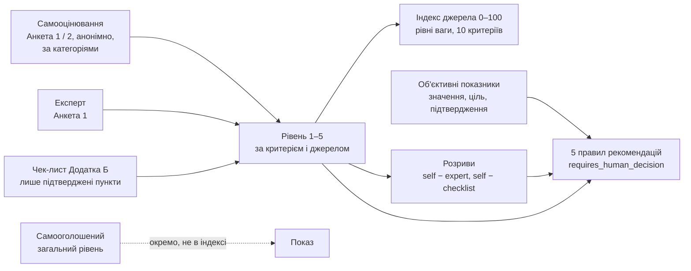

# Методика модуля «Зрілість за Додатком В» — `annex-v-maturity-0.1`

> **Статус.** Авторська демонстраційна методика команди Sys&Mints. Вона не затверджена МОУ, НУОУ, НАЗК чи закладом і працює лише на синтетичних даних. Integrity Index `team-results-demo-0.1` ([methodology.md](methodology.md)) вона не змінює: це окремий модуль з окремою версією.
>
> **Джерело.** [Рекомендації МОУ / НУОУ щодо трансформації функціонування ВВНЗ (ВНП ЗВО)](https://nuou.org.ua/assets/documents/recommendations_transform_dobrochesnist.pdf): Додаток Б (чек-лист, с. 24–52), Додаток В (анкети, с. 53–66), Додаток Г (шаблон звіту, с. 67–75). Сторінки — друковані номери.
>
> **Контракт.** Поля відповіді й маршрути визначає [API_CONTRACT.md](API_CONTRACT.md). Зіставлення критеріїв з C1–C7 і Додатком Б наведено в [annex-mapping.md](annex-mapping.md). Документ написано паралельно з реалізацією. Якщо він розходиться з кодом чи контрактом, правильними вважаються код і контракт, а документ треба виправити.

## 1. Призначення

Модуль показує, на якому рівні зрілості за моделлю НАЗК перебуває система доброчесності закладу за кожним критерієм Додатка В. Він також показує, де розходяться три погляди на цю систему: самооцінювання персоналу, експертна оцінка і задокументований стан заходів за чек-листом. Мета модуля — знайти напрями для розвитку й підготувати пропозиції для робочої групи (Етапи 2–3 Рекомендацій, с. 13–15). Модуль не оцінює людей.

## 2. Правило «варіант → рівень» і чому воно таке

**Правило:** варіант `a` = рівень 1, `b` = 2, `c` = 3, `d` = 4, `e` = 5. Виняток — питання про викривачів (розділ 2.1). Рядок `level_rule` у відповіді: `a=1…e=5; викривачі: a=1, b=2, c=3, d=4, e=4, f=5 (Додаток Г, с. 73)` (`backend/app/annex_v.py`, `LEVEL_RULE`, `LEVEL_MAPS`).

| Рівень | Назва за моделлю НАЗК |
| ---: | --- |
| 1 | Початковий |
| 2 | Керований |
| 3 | Визначений |
| 4 | Вимірюваний |
| 5 | Оптимізуючий |

Чому так:

1. **Варіанти в Додатку В упорядковані.** У кожному питанні варіанти йдуть від «немає системи» до «система постійно вдосконалюється на основі даних». Анкети побудовано за методологією CMMI (с. 13–14), а в ній рівні впорядковані за визначенням.
2. **Саме джерело ставить варіантам рівні.** Шаблон звіту Додатка Г (с. 69–74) для кожного питання має таблицю, де варіанти відповіді по черзі віднесено до рівнів «1. Початковий» … «5. Оптимізуючий». Отже, правило a–e → 1–5 відтворює таблиці Додатка Г, а не вигадане командою зіставлення.
3. **Воно просте й перевірюване.** Рівень відповіді однозначно випливає з ID варіанта (`…-a` … `…-e`). Ні ваг варіантів, ні прихованих коефіцієнтів немає.

**Що змінилося.** Раніше в коді й документах було прямо сказано, що порядок варіантів **не** визначає балів: коментар у [`frontend/src/official/catalog.ts`](../frontend/src/official/catalog.ts) («Their order does not define Integrity Index scores»), коментар у `catalog-v2.ts` («it has no score or weight») і рішення №5 у [OFFICIAL_QUESTIONNAIRE_METHOD_MAPPING.md](OFFICIAL_QUESTIONNAIRE_METHOD_MAPPING.md). Це обмеження стосувалося Integrity Index, і для нього воно лишається чинним: анкети Додатка В в індекс не потрапляють. Для модуля зрілості команда тепер **явно і задокументовано** вирішує, що позиція варіанта визначає рівень. Рішення має власну версію методики `annex-v-maturity-0.1` і спирається на таблиці Додатка Г.

### 2.1 Питання про викривачів має 6 варіантів

Питання `whistleblowers` (`av-f1-accountability-3`, с. 57–58; `av-f2-accountability-3`, с. 63–64) у джерелі має шість варіантів (`a`–`f`). Для нього діє таблиця Додатка Г, розділ 3.3 (с. 73): `a`=1, `b`=2, `c`=3, `d`=4, **`e`=4**, **`f`=5**. Тобто і `d`, і `e` мають рівень «Вимірюваний», а останній варіант `f` — «Оптимізуючий». Для решти питань правило a–e не змінюється.

Чому не просто a–e → 1–5 з відкиданням `f`: таке правило завищувало б на один рівень відповідь `e` і відкидало б найзрілішу відповідь `f`. Рівень критерію зміщувався б униз, а кількість врахованих відповідей зменшувалась би. Тому команда взяла таблицю джерела.

### 2.2 Дубль питання про відкритість в Анкеті 1

Питання `av-f1-culture-4` і `av-f1-culture-5` у джерелі однакові (с. 54–55). У Додатку Г відкритість має один рядок (1.4, с. 71). Щоб критерій `openness` не отримав подвійного внеску від респондентів Анкети 1 порівняно з Анкетою 2, ці дві відповіді спершу усереднюються в межах однієї анкети, а потім рахується середнє між анкетами. Так і реалізовано: `criterion_levels` у `backend/app/annex_v.py` дає по одному рівню критерію на анкету, тож анкета враховується для `openness` один раз.

## 3. Агрегація: рівень за критерієм і джерелом

Для кожного з 11 критеріїв (`leadership`, `ethics`, `education`, `openness`, `officer`, `strategy`, `risks`, `checks`, `whistleblowers`, `audit`, `maturity`) і кожного джерела рахується окремий рівень.

| Джерело | Формула рівня | Хто входить |
| --- | --- | --- |
| Самооцінювання (`self`) | Середнє арифметичне рівнів усіх врахованих відповідей на питання критерію, округлене до 0,1 | Усі анонімні анкети циклу (Анкета 1 і 2). Окремо рахується рівень кожної видимої категорії (`self_by_category`) |
| Експерт (`expert`) | Середнє рівнів відповідей експертів, округлене до 0,1 | Експертні оцінки за Анкетою 1, які вніс адміністратор |
| Чек-лист (`checklist`) | `1 + 4 × (yes + 0,5 × partial) / confirmed_items` | Лише **підтверджені** пункти чек-листа з цим `criterion` |

Чек-лист переводиться на ту саму шкалу 1–5 так: усі підтверджені пункти «впроваджено повністю» дають 5, усі «потребує впровадження» дають 1, «частково» рахується як половина. Шкалу «повністю / частково / потребує впровадження» взято з Додатка Б (с. 13). Половина для `partial` — припущення команди: джерело не визначає числової ваги часткового впровадження. Непідтверджені пункти не враховуються, але видно `items_total` і `items_confirmed`, тож неповнота чек-листа помітна.

Статуси рівня: `ok` — рівень є; `missing` — немає жодної відповіді чи підтвердженого пункту; `suppressed` — самооцінювання приховано через малу кількість анкет (розділ 6).

Середнє 1–5 трактує порядкові рівні як рівновіддалені. Це припущення, таке саме, як у Integrity Index ([methodology.md](methodology.md), розділ 4). Рівень 3,4 означає «між Визначеним і Вимірюваним, ближче до Визначеного», а не «3,4 рівня». Додаток Г пропонує показувати розподіл відповідей у відсотках (с. 69–74). Середнє — додатковий підсумок команди, і розподіл він не замінює.

## 4. Індекс джерела 0–100

Для кожного джерела окремо:

**Індекс = (L̄ − 1) / 4 × 100**, де **L̄ = (1/10) × Σ Lⱼ** — середнє рівнів 10 критеріїв без `maturity`.

- Вага кожного критерію дорівнює **1/10**.
- Шкала: рівень 1 → 0, рівень 3 → 50, рівень 5 → 100.
- Якщо для джерела хоча б один із 10 критеріїв має статус `missing` чи `suppressed`, індекс цього джерела дорівнює `null`. Ваги не перерозподіляються з тієї ж причини, що й в Integrity Index: інакше найслабший критерій міг би «зникнути» й підняти індекс ([methodology.md](methodology.md), розділ 5.3).
- Три індекси (`self`, `expert`, `checklist`) не зводяться в одне число. Вони відповідають на різні питання ([annex-mapping.md](annex-mapping.md), розділ 5).

Для цілих рівнів шкала індексу збігається з діапазонами рівнів у [maturity-levels.md](maturity-levels.md): 0 → рівень 1, 25 → 2, 50 → 3, 75 → 4, 100 → 5. Проте назви рівнів у тому документі («Базовий», «Середній»…) — демонстраційні назви для балів Integrity Index. Модуль зрілості використовує назви НАЗК.

### 4.1 Розрахунковий приклад (синтетичні дані)

| Критерій | `self` | `expert` | `checklist` | Як отримано рівень чек-листа |
| --- | ---: | ---: | ---: | --- |
| `leadership` | 3,4 | 2,5 | 3,0 | 3 підтверджені: 1 yes, 1 partial, 1 no → 1 + 4 × 1,5/3 = 3,0 |
| `ethics` | 3,6 | 3,0 | 3,0 | 1 yes, 1 partial, 1 no |
| `education` | 3,8 | 3,5 | 3,7 | 2 yes, 1 no → 1 + 4 × 2/3 = 3,67 → 3,7 |
| `openness` | 3,0 | 2,5 | 2,3 | 1 yes, 2 no → 1 + 4 × 1/3 = 2,33 → 2,3 |
| `officer` | 3,5 | 3,0 | 3,0 | 1 yes, 1 partial, 1 no |
| `strategy` | 3,6 | 2,5 | 3,0 | 1 yes, 1 partial, 1 no |
| `risks` | 3,1 | 2,0 | 2,3 | 1 yes, 2 no |
| `checks` | 3,3 | 2,5 | 2,3 | 1 yes, 2 no |
| `whistleblowers` | 2,9 | 2,0 | 1,7 | 1 partial, 2 no → 1 + 4 × 0,5/3 = 1,67 → 1,7 |
| `audit` | 2,6 | 1,5 | 1,0 | 3 no → 1,0 |
| **Σ** | **32,8** | **25,0** | **25,3** | |
| **L̄** | **3,28** | **2,50** | **2,53** | |
| **Індекс** | **(3,28 − 1)/4 × 100 = 57,0** | **(2,50 − 1)/4 × 100 = 37,5** | **(2,5333… − 1)/4 × 100 = 38,33** | |

Перевірка для `self`: 2,28 / 4 = 0,57 → 57,0. Самооцінювання на 19,5 пункта вище за експерта, а різниця середніх рівнів (3,28 − 2,50 = 0,78) менша за поріг розриву 1,0. Тому розрив на рівні індексу не позначається. Позначки ставляться за окремими критеріями (розділ 7).

**Точність.** Індекс рахується з **точних** (неокруглених) рівнів критеріїв, у дробах, і лише потім округлюється до 0,01 за правилом «половина вгору» (`_index` і `round_half_up` у `backend/app/services/maturity.py`). Рівні у відповіді показуються з одним знаком. Тому для чек-листа в прикладі сума точних рівнів 25,333… дає 38,33, а не 38,25, як вийшло б з округлених 2,3 і 3,7. Для `self` і `expert` приклад припускає, що точні рівні дорівнюють показаним.

## 5. Чому ваги рівні

1. **Офіційних ваг немає.** У Додатках Б, В і Г немає числових ваг критеріїв чи розділів. Шаблон звіту (Додаток Г, с. 75) пропонує оцінити загальний рівень описово, за трьома розділами разом.
2. **Нерівні ваги без джерела були б прихованим пріоритетом.** Будь-яка нерівна вага — це рішення про те, що один напрям важливіший за інший. Таке рішення має ухвалювати робоча група, а не задавати розробник непомітно в коді.
3. **Рівні ваги легко перевірити.** Індекс — це просто середній рівень, переведений у 0–100. Кожен може перерахувати його вручну з таблиці рівнів.

Наслідок, який треба знати: розділи Додатка В мають різну кількість критеріїв (Культура — 4, Система — 2, Підзвітність — 4). Тому за рівних ваг критеріїв розділ «Система» дає 20% індексу, а «Культура» і «Підзвітність» — по 40%. Integrity Index має інші, нерівні ваги C1–C7. Їх обґрунтовано в [methodology.md](methodology.md), розділ 3.

## 6. Анонімність: k і приховування

Правила ті самі, що в Integrity Index ([methodology.md](methodology.md), розділ 5; [anonymity.md](anonymity.md), розділ 4):

1. Результати видно лише після закриття циклу. Для відкритого циклу маршрут повертає 409.
2. k (`min_group_size`) береться з циклу. Типове значення 5 — демонстраційне налаштування.
3. **Первинне приховування:** категорія самооцінювання з кількістю анкет менше k прихована: `level=null`, `hidden=true`.
4. **Вторинне приховування:** якщо прихована група сумарно менша за k і її можна відновити з різниці із загальним підсумком, приховується ще найменша видима категорія (як у `anonymity.py`, `hidden_flags`).
5. Загальний рівень самооцінювання за критерієм і самооголошений загальний рівень показуються лише якщо загальна кількість анкет не менша за k. Інакше `status=suppressed`, а індекс `self` дорівнює `null`.
6. Відповідь на анкету не має зв'язку з обліковим записом, а дата зберігається без часу. Код доступу одноразовий, і категорія коду має збігатися з категорією відповіді.
7. Експертна оцінка не анонімна, але не містить персональних даних. `expert_label` — посада чи роль, а не ім'я. Правило k до експертів не застосовується, бо це професійна оцінка, а не опитування персоналу. Кількість експертів (`experts`) видно у відповіді.
8. Рекомендації не згадують прихованих категорій і не відновлюють їх значень.

## 7. Розриви між джерелами

| `rule_id` | Ліва частина | Права частина | Умова позначки |
| --- | --- | --- | --- |
| `MAT_SELF_EXPERT_GAP_GE_1` | `self` | `expert` | `self − expert ≥ 1,0` |
| `MAT_SELF_CHECKLIST_GAP_GE_1` | `self` | `checklist` | `self − checklist ≥ 1,0` |

`diff` показується завжди, коли обидва рівні наявні. `flag=true` ставиться лише якщо різниця не менша за 1,0. Якщо хоча б один рівень `null`, розрив не рахується.

Чому поріг 1,0 рівня:

1. **Один рівень — найменша змістовна різниця.** Рівні моделі НАЗК описують якісно різні стани системи (наприклад, «політики затверджено» і «політики доведено до всіх і впроваджуються»). Різниця на цілий рівень означає, що джерела описують різні стани, а не одне й те саме з невеликим зсувом.
2. **Менші різниці часто є шумом.** Рівні округлено до 0,1. Експертів зазвичай мало, а рівень чек-листа за 3 пунктами змінюється кроками по 0,67 (одна зміна з `no` на `partial`). Різниця 0,3–0,7 може з'явитися через одну відповідь.
3. **Поріг відповідає порогу розриву Integrity Index.** Рівень 1,0 дорівнює 25 пунктам шкали 0–100, тобто порогу `CATEGORY_GAP_GE_25_V1` ([methodology.md](methodology.md), розділ 7.1).

Приклад із розділу 4.1. Позначки `self − expert` отримують `strategy` (3,6 − 2,5 = 1,1), `risks` (1,1) і `audit` (1,1). Позначки `self − checklist` отримують `checks` (3,3 − 2,3 = 1,0, межа включна), `whistleblowers` (1,2) і `audit` (1,6). Інші різниці менші за 1,0. Різниця рахується з рівнів, округлених до 0,1, і порівнюється з порогом після округлення до 0,1. Тоді двійкове подання дробів не перетворить 1,0 на 0,999… і межовий випадок не загубиться.

Розрив однобічний: позначається лише випадок, коли самооцінювання **вище** за експерта чи чек-лист. Саме цей випадок вказує на ризик завищеної самооцінки, коли сприйняття випереджає задокументовану практику. Протилежний випадок (персонал оцінює нижче, ніж показують документи) теж важливий, але свідчить про іншу проблему: заходи існують, але їх не видно або їм не довіряють. Його видно у `diff`, але окремого правила немає. Поріг 1,0 авторський, а не статистичний тест.

## 8. Правила рекомендацій

Усі пропозиції мають `requires_human_decision=true`, конкретний `basis` (вхідні значення) і стабільний `rule_id`. Система не призначає відповідальних і строків. Рішення ухвалює робоча група. Правила застосовуються до кожного з 10 критеріїв без `maturity`.

| `rule_id` | Умова | Поріг | Обґрунтування |
| --- | --- | --- | --- |
| `MAT_LOW_LEVEL_LT_3` | Рівень експерта, а якщо експертної оцінки немає — рівень самооцінювання, `< 3` | 3,0, строго `<` | Рівень 3 «Визначений» — це стан, коли процеси стандартизовані й доведені до всіх. Нижче за нього система ще не стала системою. Експертна оцінка має пріоритет, бо вона менше залежить від соціально бажаних відповідей |
| `MAT_SELF_EXPERT_GAP_GE_1` | `self − expert ≥ 1,0` | 1,0 рівня | Розділ 7 |
| `MAT_SELF_CHECKLIST_GAP_GE_1` | `self − checklist ≥ 1,0` | 1,0 рівня | Розділ 7 |
| `MAT_OBJECTIVE_BELOW_TARGET` | Підтверджений об'єктивний показник критерію нижчий за ціль, а `self ≥ 3,5` | ціль показника; 3,5 | Високе сприйняття (ближче до «Вимірюваного») при фактичному відставанні від цілі вказує, що варто перевірити, на чому ґрунтується висока оцінка |
| `MAT_OBJECTIVE_UNCONFIRMED` | `self ≥ 4`, а об'єктивних показників критерію немає або жоден не підтверджений | 4,0 | Рівень 4 «Вимірюваний» за визначенням означає, що цілі встановлено й виміряно. Без підтверджених вимірювань такий рівень нічим не підкріплений |

У прикладі з розділу 4.1 `MAT_LOW_LEVEL_LT_3` спрацьовує для 7 критеріїв, де рівень експерта нижчий за 3: `leadership`, `openness`, `strategy`, `checks` (по 2,5), `risks`, `whistleblowers` (по 2,0) і `audit` (1,5). Правила розривів дають ще 6 пропозицій (розділ 7). Правила з об'єктивними показниками залежать від внесених показників.

Пропозиція — це привід для обговорення, а не висновок. Наприклад, `MAT_SELF_EXPERT_GAP_GE_1` може означати як завищену самооцінку, так і те, що експерт не бачить частини практик.

## 9. Самооголошений загальний рівень показується окремо

Критерій `maturity` — це питання розділу 4 обох анкет (с. 58–59 і 64–65): респондент обирає один з п'яти описів рівня зрілості закладу загалом. Цей рівень **не входить** в індекси:

1. **Це не окремий напрям, а підсумкове судження.** Інші 10 критеріїв оцінюють конкретні механізми, а `maturity` — усю систему разом. Якщо додати його до середнього, ті самі механізми було б враховано двічі.
2. **Розбіжність сама по собі інформативна.** Порівняння самооголошеного рівня із середнім рівнем 10 критеріїв показує, наскільки цілісне уявлення респондентів про систему збігається з їхніми оцінками окремих механізмів. Якщо загальний рівень помітно вищий, люди оцінюють систему загалом краще, ніж її складники.
3. **Так влаштоване й джерело.** Шаблон звіту Додатка Г показує розділ 4 окремою таблицею (с. 74). Висновок про загальний рівень (с. 75) робиться за розділами «Культура», «Система» і «Підзвітність».

`overall_self_declared` має ті самі правила k, що й самооцінювання за критеріями.

## 10. Обмеження

1. Методика демонстраційна й не затверджена. Правило «варіант → рівень», рівні ваги, поріг 1,0 і пороги правил — рішення команди, а не джерела. Таблиці Додатка Г підтримують порядок рівнів, але не середні значення.
2. Анкети в каталозі `2.0.0` — стислі адаптації тексту джерела, а не дослівні копії ([OFFICIAL_QUESTIONNAIRE_METHOD_MAPPING.md](OFFICIAL_QUESTIONNAIRE_METHOD_MAPPING.md)). Скорочення описів може змінити вибір респондента.
3. Порядкові рівні усереднюються як рівновіддалені. Середнє ховає поляризацію: половина відповідей 1 і половина 5 дають той самий рівень 3, що й усі відповіді 3. Тому поруч із середнім варто показувати розподіл, як пропонує Додаток Г.
4. Критерію `leadership` немає в Анкеті 2 (особовий склад). Самооцінювання цього критерію дають лише респонденти Анкети 1. Якщо їх менше за k, рівень `leadership` у `self` прихований, і через це прихований увесь індекс `self`.
5. Розбіжність правила для `whistleblowers` з Додатком Г (розділ 2.1) і подвійне питання про відкритість (розділ 2.2) ще потребують рішення й звірки з кодом.
6. Чек-лист: «частково» = 0,5 — припущення. Рівень чек-листа залежить від того, скільки пунктів віднесено до критерію і скільки з них підтверджено. Віднесення пунктів до критеріїв тематичне ([annex-mapping.md](annex-mapping.md), розділ 2).
7. C4 «Доброчесність освітнього процесу» модуль не вимірює, бо Додаток В не має такого критерію ([annex-mapping.md](annex-mapping.md), розділ 3).
8. Експертів мало. Рівень одного експерта — це думка однієї людини, а статистичної похибки модуль не оцінює.
9. Об'єктивні показники вносяться вручну. Модуль перевіряє, що їх підтвердила інша людина, але не перевіряє самих доказів.
10. k = 5 — демонстраційне налаштування. Соціально бажані відповіді й тиск на респондентів технічно не усуваються ([abuse-analysis.md](abuse-analysis.md), розділ 5).
11. Порівняння циклів модуль не виконує. Для нього потрібні та сама версія анкет, методики, категорій і k.

## 11. Розвиток, а не покарання

- **Об'єкт оцінювання — система закладу, а не людина.** Критерії описують процеси: навчання, канали повідомлень, аудит тощо. Ні рівень, ні індекс не є оцінкою роботи конкретного начальника, уповноваженого чи підрозділу.
- **Порівнювати окремих командирів не можна.** Модуль не має розбивки за підрозділами чи посадовими особами, а лише за категоріями респондентів. Самооцінювання анонімне і приховує малі групи. Експерт вказується посадою, а не ім'ям, і оцінює заклад, а не людей. Маршрутів «рейтинг керівників» немає, і додавати їх не можна ([abuse-analysis.md](abuse-analysis.md), розділ 9).
- **Результат є точкою відліку.** Рекомендації джерела саме так описують мету діагностики: визначити сильні й слабкі місця і цільовий рівень на наступний період (Додаток Г, с. 67), а потім закласти заходи в План трансформації (Етап 3, с. 15).
- **Рішення ухвалює людина.** Кожна пропозиція має `requires_human_decision=true`. Низький рівень — підстава для заходу розвитку, а не для дисциплінарного рішення.
- **Не карати за чесність.** Якщо низький рівень самооцінювання призводить до санкцій, наступного разу відповіді стануть «кращими», і модуль утратить сенс. Тому результати не можна використовувати в службових характеристиках, атестації чи для розподілу премій.
