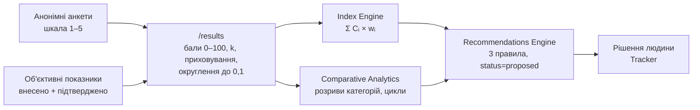

# Методика Integrity Index — `team-results-demo-0.1`

> **Статус.** Авторська демонстраційна методика команди: `approval_status=proposed`, `official=false`, `synthetic_only=true`. Це не затверджена методика МОУ, НАЗК чи закладу. Усі числа в прикладах — синтетичні дані з `backend/app/seed.py`.
>
> **Звірено з кодом** гілки `integration/main-final`, коміт `584e930`. Якщо документ розходиться з кодом, правильним вважається код. Розбіжність треба повідомити команді, щоб виправити документ.

| Що | Де в коді |
| --- | --- |
| Версія, ваги, формула, статуси, точність | [`backend/app/services/scoring.py`](../backend/app/services/scoring.py): `VERSION`, `WEIGHTS`, `RULES`, `calculate_index`, `methodology` |
| Порівняння категорій, об'єктивний контекст, порівняння циклів | [`backend/app/services/analytics.py`](../backend/app/services/analytics.py): `compare_categories`, `objective_context`, `compare_periods` |
| Правила рекомендацій | [`backend/app/services/recommendations.py`](../backend/app/services/recommendations.py): `generate_recommendations` |
| HTTP-маршрути аналітики | [`backend/app/routes/analytics.py`](../backend/app/routes/analytics.py) |
| Агрегати, поріг k, приховування | [`backend/app/routes/results.py`](../backend/app/routes/results.py): `assessment_results`; [`backend/app/anonymity.py`](../backend/app/anonymity.py): `hidden_flags` |
| Компоненти, ваги в БД, синтетичні дані | [`backend/app/seed.py`](../backend/app/seed.py): `COMPONENTS`, `QUESTIONS`, `CATEGORIES`, `OBJECTIVE`, `CYCLES` |
| Тести формули й правил | [`backend/tests/test_scoring.py`](../backend/tests/test_scoring.py) |

## 1. Призначення і принципи

Integrity Index узагальнює стан системи доброчесності закладу за результатами анонімного самооцінювання. Він допомагає побачити сильні та слабкі компоненти, сформувати пропозиції рекомендацій і порівняти цикли оцінювання. Індекс описує систему, а не людей.

1. **Розвиток, а не покарання.** Індекс не призначений для рейтингу посадових осіб, підрозділів чи для дисциплінарних рішень. Маршрутів «рейтинг керівників» немає. Ризик зловживання й запобіжники описано в [abuse-analysis.md](abuse-analysis.md), розділ 9.
2. **Рішення ухвалює людина.** Система лише пропонує: кожна рекомендація має `status=proposed` і `requires_human_decision=true`. Відповідального й строк вона не призначає.
3. **Прозорість.** Формулу, точні ваги, пороги й обмеження повертає `GET /api/index-methodologies/team-results-demo-0.1`. Відповіді індексу й рекомендацій містять версію методики та SHA-256 конфігурації й вхідних даних.
4. **Анонімність важливіша за деталізацію.** Аналітика бачить лише агрегати після приховування малих груп і нічого прихованого не відновлює.
5. **Відсутні дані не дорівнюють нулю.** `null` ніколи не перетворюється на 0, ваги не перерозподіляються.
6. **Детермінованість.** Під час розрахунку не використовуються ні ШІ, ні випадковість. Арифметика точна (`fractions.Fraction`). Однаковий вхід дає однаковий результат (`test_manual_exact_formula_immutable`, `test_threshold_rules_and_stable_ids`).
7. **Версіонування.** Нові компоненти, ваги чи пороги означають нову версію методики, яку затверджує людина. Обчислювальні маршрути приймають лише явно вказану версію `methodology=team-results-demo-0.1`. Без параметра або з іншою версією вони повертають 422.

## 2. Джерела даних

| Джерело | Зміст | Код | Вплив на індекс |
| --- | --- | --- | --- |
| Анонімні анкети (Survey) | Відповіді за шкалою 1–5 на 14 демонстраційних тверджень (по 2 на компонент), категорія респондента, підрозділ із довідника | `models.py`: `ResponseSet`, `Answer`; `seed.py`: `QUESTIONS` | **Єдине джерело** |
| Агреговані результати `/results` | Середні бали 0–100 за компонентами загалом і за категоріями, уже після приховування | `routes/results.py`: `assessment_results` | Вхід Index Engine |
| Об'єктивні показники | Значення 0–100 (%), роль, яка внесла показник, роль, яка підтвердила, ознака `confirmed` | `models.py`: `ObjectiveIndicator` | **Не впливають**, лише контекст (розділ 7.3) |
| Персональні тестування V2 | Особисті спроби користувачів | `v2_auth.db` | Не впливають ([V2_INTEGRATION_CONTRACT.md](V2_INTEGRATION_CONTRACT.md), розділи 1 і 6) |
| Експертне оцінювання | Не реалізовано | `calculate_index`: `expert.status=not_available` | Не впливає |

Категорії респондентів: `mgmt` — керівництво, `npp` — науково-педагогічні працівники, `cadets` — курсанти, `staff` — персонал (`services/reporting.py`, `CATEGORY_NAMES`). Усі чотири категорії є самооцінюванням. Категорія `mgmt` не є незалежним експертом.

Компоненти й твердження seed орієнтовні. Їх не зіставлено офіційно з додатками Б і В Рекомендацій НУОУ (коментар у `seed.py` і обмеження `No approved mapping to appendices B/V` у `methodology()`). Адаптовані анкети додатка В реалізовано окремо як попередній перегляд ([OFFICIAL_QUESTIONNAIRE_METHOD_MAPPING.md](OFFICIAL_QUESTIONNAIRE_METHOD_MAPPING.md)). В індекс вони не потрапляють. Відповіді за ними, експертні оцінки й чек-лист Додатка Б обробляє окремий модуль «Зрілість за Додатком В» ([maturity-annex-v.md](maturity-annex-v.md)).

## 3. Компоненти C1–C7 і ваги

| Код | Компонент | Вага | Точний дріб | Тверджень | Об'єктивний показник у seed |
| --- | --- | ---: | ---: | ---: | --- |
| C1 | Лідерство й тон керівництва | 0,15 | 3/20 | 2 | Виконання заходів, закріплених за керівництвом, % |
| C2 | Антикорупційна політика і процедури | 0,15 | 3/20 | 2 | Актуальність антикорупційної програми, % |
| C3 | Управління корупційними ризиками | 0,15 | 3/20 | 2 | Ризики з реєстру, щодо яких виконано заходи, % |
| C4 | Доброчесність освітнього процесу | 0,20 | 1/5 | 2 | Скарги на оцінювання, розглянуті вчасно, % |
| C5 | Навчання і комунікація | 0,10 | 1/10 | 2 | Персонал, що пройшов навчання, % |
| C6 | Повідомлення про порушення | 0,15 | 3/20 | 2 | Повідомлення, на які відреаговано у строк, % |
| C7 | Моніторинг і контроль | 0,10 | 1/10 | 2 | Виконання плану заходів, % |
| | **Разом** | **1,00** | **1** | **14** | |

Ваги записуються в таблицю `components` із `seed.py` (`COMPONENTS`). Ті самі ваги зафіксовано як точні десяткові рядки в `scoring.py` (`WEIGHTS`). Перед розрахунком `_validate` порівнює ваги з `/results` з `WEIGHTS`. Якщо ваги в БД змінено без нової версії методики, маршрут повертає 409 `Results do not match the selected demo methodology`. Ваги також публічно видно в `GET /api/assessments/{id}/questionnaires`.

Ваги не є офіційними: ні Рекомендації НУОУ, ні Методичні рекомендації НАЗК числових ваг не встановлюють. Це **задокументоване демонстраційне припущення команди**. Його треба відкалібрувати разом із робочою групою закладу, і будь-яка зміна ваг означає нову версію методики (розділ 1, принцип 7).

### 3.1 Обґрунтування ваг

| Група | Компоненти | Вага кожного | Разом | Чому |
| --- | --- | ---: | ---: | --- |
| Основний процес закладу | C4 | 0,20 | 0,20 | Див. нижче |
| Ядро антикорупційної системи | C1, C2, C3, C6 | 0,15 | 0,60 | Тон керівництва, політики, ризики й повідомлення про порушення — базові елементи моделі зрілості НАЗК. Кожен має прямий критерій Додатка В і окремі пункти Додатка Б ([annex-mapping.md](annex-mapping.md), розділ 2). Підстав вважати один із них важливішим за інші немає, тому ваги в групі рівні |
| Забезпечувальні процеси | C5, C7 | 0,10 | 0,20 | Див. нижче |

**Чому C4 = 0,20.** Об'єкт демонстрації — вищий військовий навчальний заклад. Освітній процес і академічна доброчесність є його основним процесом: саме тут формуються етичні стандарти майбутніх офіцерів (Вступ Рекомендацій, с. 3). Додаток Б присвячує цьому два з шести розділів: розділ 3 «Освітній процес» (с. 30–31) і розділ 5 «Академічна доброчесність» (с. 44–47). Водночас анкети Додатка В цього напряму не мають зовсім ([annex-mapping.md](annex-mapping.md), розділ 3). Тож Integrity Index — єдине місце в системі, де вимірюється сприйняття доброчесності освітнього процесу, і команда свідомо дає йому найбільшу вагу. Крім того, з цим процесом щодня стикається найбільша категорія респондентів — курсанти (у seed 78,4% анкет).

**Чому C5 і C7 = 0,10.** Навчання й комунікація (C5) та моніторинг і контроль (C7) — забезпечувальні процеси. Вони не є результатом самі по собі, а підтримують інші компоненти. Якісне навчання має проявитися в C2 і C6, а дієвий моніторинг — у C3. Повна вага створила б ризик подвійного врахування того самого ефекту. Крім того, обидва компоненти частково покриваються об'єктивними показниками, які вимірюються надійніше за сприйняття: «Персонал, що пройшов навчання, %» і «Виконання плану заходів, %» (розділ 3, таблиця). Ці показники не входять в індекс, але показуються поруч як контекст (розділ 7.3).

Обмеження обґрунтування: це експертне судження команди, а не результат опитування експертів чи статистичної процедури. Тому поруч наведено чутливість індексу до ваг (розділ 3.2).

### 3.2 Чутливість до ваг: порівняння з рівними вагами

Для перевірки індекс перераховано з рівними вагами 1/7 для всіх компонентів за тими самими балами seed. Бали 2025-II взято з розділу 10. Бали 2026-I і 2026-II отримано як бали 2025-II плюс зміни з таблиці розділу 8. Вони точно відтворюють індекси 51,47 і 54,345.

| Цикл / група | II, ваги 0,15…0,10 | II, рівні ваги 1/7 | Різниця |
| --- | ---: | ---: | ---: |
| 2025-II, загальний | 48,395 | 347,6 / 7 = 49,657 | +1,26 |
| 2026-I, загальний | 51,47 | 369,4 / 7 = 52,771 | +1,30 |
| 2026-II, загальний | 54,345 | 389,6 / 7 = 55,657 | +1,31 |
| 2025-II, `cadets` | 46,79 | 337,5 / 7 = 48,214 | +1,42 |
| 2025-II, `npp` | 53,32 | 377,6 / 7 = 53,943 | +0,62 |

Висновки:

- На seed-даних рівні ваги піднімають індекс на 0,6–1,4 бала. Причина: низький C4 (41,0) за рівних ваг важить менше, а високий C5 (64,1) — більше. Отже, обрані ваги трохи **посилюють** вплив слабкого місця освітнього процесу.
- Зони не змінюються. 48,395 і 49,657 обидва в проблемній зоні (нижче 50), а індекси 2026-I і 2026-II в обох варіантах у стабільній зоні ([maturity-levels.md](maturity-levels.md)).
- Зміни між циклами майже однакові: +3,075 проти +3,114 і +2,875 проти +2,886.
- Пропозиції рекомендацій від ваг не залежать: правила `LOW_SCORE_LT_50_V1` і `CATEGORY_GAP_GE_25_V1` застосовуються до балів компонентів, а не до індексу.
- Найбільша можлива різниця між двома наборами ваг для будь-яких балів 0–100 становить 100 × (4 × (0,15 − 1/7) + (0,20 − 1/7)) = 100 × 12/140 ≈ **8,57 бала**. Вона досягається в крайньому випадку: C1–C4 і C6 мають 100 балів, а C5 і C7 — 0, або навпаки.

### 3.3 Модуль «Зрілість за Додатком В» має рівні ваги

Окремий модуль `annex-v-maturity-0.1` рахує індекси 0–100 для самооцінювання, експерта й чек-листа з **рівними** вагами 1/10 для 10 критеріїв Додатка В. Причина: для критеріїв Додатка В офіційних ваг немає, і модуль не повинен вносити прихованих пріоритетів. Модуль не змінює Integrity Index і не використовує ваг C1–C7. Методика модуля описана в [maturity-annex-v.md](maturity-annex-v.md), зіставлення критеріїв з C1–C7 і Додатком Б — в [annex-mapping.md](annex-mapping.md).

## 4. Розрахунок крок за кроком

### Крок 1. Відповідь перетворюється на бал 0–100

`бал = (відповідь − min) / (max − min) × 100` (SQL-вираз у `assessment_results`).

| Відповідь за шкалою 1–5 | 1 | 2 | 3 | 4 | 5 |
| --- | ---: | ---: | ---: | ---: | ---: |
| Бал | 0 | 25 | 50 | 75 | 100 |

Порядкову шкалу трактуємо як рівновіддалену. Це припущення. Бал 75 не означає «75% доброчесності». Якщо шкала має одне значення (`min = max`), `NULLIF` дає `NULL`, і `AVG` пропускає таку відповідь. Ураховуються лише питання анкети персоналу (`Question.kind = "survey"`).

### Крок 2. Бал компонента в категорії

`C(i, g)` — середнє арифметичне балів усіх відповідей категорії `g` на питання компонента `i` у циклі. У seed кожна анкета дає 2 відповіді на компонент. Питання всередині компонента мають однакову неявну вагу.

### Крок 3. Загальний бал компонента

`Cᵢ` — середнє всіх відповідей циклу на питання компонента `i` в усіх категоріях, **зокрема прихованих**. Це не середнє балів категорій. Кожна анкета має однакову вагу, тому найбільша категорія домінує. У seed курсанти дають 210 із 268 анкет (78,4%). Загальний бал показується, лише якщо загальна кількість анкет не менша за k.

### Крок 4. Округлення входу

`/results` округлює кожен бал до 0,1 (`_round`, тобто `round(x, 1)` у Python). Саме ці числа є входом індексу (`input_precision = rounded_component_scores_1_decimal`). Повторного перетворення шкали немає.

### Крок 5. Integrity Index

**II = Σ (Cᵢ × wᵢ), i = 1…7**

- `Cᵢ` — округлений загальний бал компонента, `wᵢ` — його вага.
- Внесок компонента: `contributionᵢ = Cᵢ × wᵢ`.
- Обчислення виконуються точно в `Fraction`. Відповідь містить `index` (округлено до 0,01 для показу) і `index_exact` (точний дріб, наприклад `"9679/200"`). Для кожного компонента: `score`, `weight`, `weight_exact`, `contribution`, `contribution_exact`, `status`.
- Σwᵢ = 1, тому 0 ≤ II ≤ 100. Підвищення C1 на 1 бал підвищує індекс рівно на 0,15 (`test_monotonicity`).

### Крок 6. Індекс видимої категорії

Та сама формула застосовується до `C(i, g)`. Індекс категорії рахується, лише якщо категорія видима, жодна з її семи клітинок не прихована і всі сім балів наявні. Інакше `index=null` зі статусом `suppressed` або `missing`.

### Крок 7. Статуси

| Рівень | Статус | Коли |
| --- | --- | --- |
| Компонент | `ok` | Бал наявний |
| Компонент | `missing` | Загальна кількість анкет видима, але бала компонента немає |
| Компонент | `suppressed` | Загальна кількість анкет менша за k |
| Індекс | `ok` | Усі 7 компонентів мають статус `ok` |
| Індекс | `insufficient_data` | Хоча б один компонент `missing`; ваги не перерозподіляються |
| Індекс | `suppressed` | Загальна кількість анкет менша за k |
| Категорія | `ok` | Категорія видима і має всі 7 балів |
| Категорія | `missing` | Категорія видима, але бракує хоча б одного бала |
| Категорія | `suppressed` | Прихована сама категорія або хоча б одна її клітинка, або загальна кількість анкет менша за k |

### Крок 8. Перевірка вхідних даних

`_validate` виконується перед будь-яким розрахунком. Вимоги:

- цикл закритий;
- k — ціле число, не менше 1;
- `responses_total` дорівнює `null` або не менше k;
- рівно сім компонентів C1–C7, ваги дорівнюють `WEIGHTS`;
- бали — скінченні числа від 0 до 100, а не рядки, boolean, NaN чи Infinity;
- категорії не повторюються, видима категорія має не менше k анкет;
- `hidden` і `confirmed` — boolean, клітинки відповідають категоріям.

Порушення будь-якої вимоги дає `ResultsContractError`, маршрут повертає 409.

### Точність і округлення

- Кожен `Cᵢ` відрізняється від неокругленого середнього не більше ніж на 0,05. Σwᵢ = 1, тому похибка індексу від округлення входу не перевищує 0,05 бала (поле `precision`). Статистична похибка вибірки не оцінюється.
- Для показу `index` округлює функція `present()`, тобто `round(float(x), 2)`. Для точних половин у третьому знаку результат залежить від двійкового подання числа. У seed 48,395 показується як `48.4`, а 54,345 — як `54.34`. Тому сума показаних внесків може відрізнятися від показаного індексу на 0,01. Для перевірки використовуйте поля `*_exact`. Зміни між циклами рахуються з точних значень.

### Аудит

- `audit.config_sha256` — SHA-256 канонічного JSON зі словника `RULES` (версія, ваги, правило пропусків, точність входу, пороги, джерело, статус затвердження). На коміті `584e930` для версії 0.1 це `5c4ea96c42b86d989387fbc89abc7e5cd92636684821320c7887842c5d5beaff`.
- `audit.input_sha256` — SHA-256 вхідних даних `/results`.
- З цих значень формується відтворюваний `id` кожної рекомендації.

## 5. Анонімність і приховування

### 5.1 Мінімальний розмір групи k

- k зберігається в `cycles.min_group_size`, типове значення 5 (`models.py`, `Cycle`). Для циклів, створених через `POST /api/assessments`, k можна задати від 5 до 1000. Після створення його змінити не можна ([ASSESSMENT_MANAGER_V2.md](ASSESSMENT_MANAGER_V2.md)).
- k = 5 — демонстраційне налаштування, а не гарантія анонімності для реальних даних.
- Index Engine бере k з `/results` і власного порога не має.

### 5.2 Правила приховування

1. Результати доступні лише після закриття циклу. Для відкритого `/results` повертає 409, бо порівняння «до/після» розкрило б щойно подану анкету.
2. **Первинне приховування:** категорія з кількістю анкет менше k прихована.
3. **Вторинне приховування:** у межах кожного відомого підсумку сума прихованих груп дорівнює 0 або не менша за k. Інакше приховується найменша видима група (`anonymity.py`, `hidden_flags`). Деталі й тести — у [anonymity.md](anonymity.md), розділ 4.
4. Прапорці категорій однакові для всіх семи компонентів.
5. Якщо загальна кількість анкет менша за k, `responses_total=null`, усі загальні бали `null`, індекс і всі категорії мають статус `suppressed`.
6. Прихована категорія має `responses=null`, `score=null`, `hidden=true`. Індекс для неї не рахується. Порівняння з нею має `status=unavailable`, `gap_points=null`, `flag=null`. Рекомендації не згадують приховані категорії в `basis` (`test_hidden_never_reconstructed`).
7. Якщо прихована хоча б одна клітинка видимої категорії, індекс цієї категорії дорівнює `null` (`test_cell_hidden_flag_is_stricter_than_category`).

Загальний бал компонента містить відповіді прихованих категорій (крок 3). З різниці між загальним балом і видимими категоріями можна оцінити лише середнє **об'єднаної** прихованої групи. Вторинне приховування гарантує, що в ній не менше k анкет. Бал окремої малої категорії так не відновити.

### 5.3 Відсутні дані ніколи не дорівнюють нулю

| Ситуація | Що повертає система | Чого система не робить |
| --- | --- | --- |
| Немає бала компонента | `score=null`, `status=missing`; індекс `null`, `status=insufficient_data` | Не підставляє 0 і не рахує індекс із шести компонентів |
| Прихована група | `null` і `hidden=true` | Не відновлює значення з різниці |
| Непідтверджений об'єктивний показник | `objective_value=null`, `status=unverified` | Не використовує значення |
| Невідома планова кількість учасників | `coverage.response_rate=null` | Не вигадує знаменник |

**Чому ваги не перерозподіляються.** У seed-циклі 2025-II компонент C6 має найнижчий бал 34,2. Якби його не було, перерозподіл ваг дав би (48,395 − 5,13) / 0,85 = 50,9. Найслабший компонент зник би, а індекс «покращився» б на 2,5 бала. Код замість цього повертає `index=null` (`test_missing_does_not_redistribute_weights`).

### 5.4 Приклад із seed

У seed k = 5, а категорії мають 210 (`cadets`), 48 (`npp`), 6 (`mgmt`) і 4 (`staff`) анкети (`seed.py`, `CATEGORIES`).

- `staff` приховано первинно: 4 < 5.
- `mgmt` приховано вторинно: інакше 268 − 210 − 48 − 6 = 4 розкрило б `staff`.
- Видимі лише `cadets` і `npp`.

Seed навмисно задає вищу самооцінку керівництва (`BASE_LEVEL`). Але ця група прихована, тому її не видно ні в індексі категорій, ні в правилі розриву. Це правильна поведінка: анонімність важливіша за деталізацію.

## 6. Інтерпретація: зони і рівні зрілості

- Пороги зон (критична, проблемна, сильна) і рівні зрілості визначено в [maturity-levels.md](maturity-levels.md). Тут вони не дублюються.
- На коміті `584e930` код аналітики не присвоює зон чи рівнів (обмеження `no official maturity labels` у `methodology()`). Зони — шар тлумачення поверх балів.
- Поріг правила `LOW_SCORE_LT_50_V1` (строго менше 50) збігається з верхньою межею проблемної зони. Окремого правила для критичної зони в коді немає.
- Правила читання:
  1. Спершу дивіться на компоненти, потім на індекс. Середнє зважене компенсаторне: високий C5 може приховати низький C6.
  2. Бал описує сприйняття за порядковою шкалою, а не частку виконаних вимог.
  3. Зміну на 1–2 бали між циклами не варто тлумачити без додаткових даних (розділ 8).
  4. Зона — привід для обговорення, а не висновок про людей.

## 7. Рекомендації (Recommendations Engine)

### 7.1 Правила

| `rule_id` | Умова | Поріг | Текст пропозиції | Рішення людини |
| --- | --- | --- | --- | --- |
| `DATA_QUALITY_V1` | Статус компонента не `ok` (`missing` або `suppressed`) | — | «Перевірити допустимість агрегованих даних; не розкривати приховані групи.» | Обов'язкове (`requires_human_decision=true`) |
| `LOW_SCORE_LT_50_V1` | Видимий загальний бал компонента менше 50 | 50 балів, строго `<` | «Переглянути практики компонента «‹назва›» та погодити план покращення.» | Обов'язкове |
| `CATEGORY_GAP_GE_25_V1` | Для того самого компонента \|бал категорії A − бал категорії B\| ≥ 25, обидві категорії видимі | 25 балів (п.п.), `≥` | «Перевірити трактування питання й причини розбіжності між видимими категоріями.» | Обов'язкове |

Тексти й пороги взято з `recommendations.py` і `analytics.py` (`threshold_points=25`). Обидва пороги авторські, а не статистичні тести.

### 7.2 Властивості пропозицій

- Поля: `id` — перші 24 символи SHA-256 від `assessment_id`, `rule_id`, `component_code`, `basis` і `audit`. Тому `id` відтворюваний. Також є `basis` (конкретні вхідні значення), `text`, `status=proposed`, `owner_role=null`, `due_date=null`, `requires_human_decision=true`.
- Для одного компонента `DATA_QUALITY_V1` і `LOW_SCORE_LT_50_V1` взаємовиключні. Правило розриву додає по одній пропозиції на кожну позначену пару категорій.
- Якщо загальна кількість анкет менша за k, усі сім компонентів отримують `DATA_QUALITY_V1`.
- Пороги застосовуються до значень `/results`, уже округлених до 0,1. Неокруглене 49,96 стане 50,0, і правило низького бала не спрацює. Розрив 24,9 не спрацьовує, розрив 25,0 спрацьовує (`test_gap_below_boundary`, `test_threshold_rules_and_stable_ids`).
- GET-маршрут нічого не записує (`persistence: "none; human acceptance and Tracker storage are a separate command"`) і не змінює індекс.

### 7.3 Об'єктивний контекст

Відповідь `/recommendations` окремо містить `objective_context`. Для кожного об'єктивного показника там є `survey_score`, `objective_value` (лише якщо `confirmed=true`, інакше `null`), `status` (`ok` або `unverified`), `comparison_type=context_only` і `gap_points=null`. Різниця не обчислюється: бал сприйняття і операційний відсоток — різні величини. Крім того, `/results` не надає ідентифікаторів метрик, одиниць і посилань на докази. Факти не коригують індекс (`test_objective_context_separate`). Приклад наведено в [objective-comparison-example.md](objective-comparison-example.md).

### 7.4 Від пропозиції до рішення

Доменна функція `services/tracker.py` (`transition`) дозволяє такі переходи:

- `proposed → accepted | rejected`;
- `accepted → in_progress → completed → verified`;
- повернення `completed → in_progress`.

Прийняття потребує рішення названої людини, причини, відповідального й строку. Виконання й перевірка потребують посилань на докази. Перевірка вимагає іншого циклу оцінювання. `overdue` — розрахунковий прапорець, а не статус. На коміті `584e930` Tracker не має HTTP API і зберігання ([integration-map.md](integration-map.md), розділ 6). Демо-рекомендації в seed мають статуси `done`, `overdue` і `in_progress` за переліком у `models.py`. Статуси `done` і `overdue` не збігаються зі статусами доменної функції.

## 8. Порівняння циклів (обмежена зіставність)

- Функція `compare_periods(before, after)`, маршрут `GET /api/analytics/comparisons?assessment_id=<до>&comparison_assessment_id=<після>&methodology=team-results-demo-0.1`. Порядок задає клієнт. Однакові ID дають 422.
- `change = II_після − II_до` рахується з точних значень. Зміну також показано для кожного компонента.
- Якщо обидва індекси наявні, статус завжди `limited_comparability`, інакше `unavailable`. До відповіді додаються три застереження:
  1. хронологія не виводиться з ID;
  2. `/results` не містить складу популяції та історичних версій анкет;
  3. числова зміна не доводить причинного покращення.

Результати seed (цикл 2026-II у seed відкритий; його значення отримано після закриття в окремій тимчасовій копії БД):

| Порівняння | II до | II після | `change_points` (`change_exact`) | C1 | C2 | C3 | C4 | C5 | C6 | C7 |
| --- | ---: | ---: | ---: | ---: | ---: | ---: | ---: | ---: | ---: | ---: |
| 2025-II → 2026-I | 48,395 | 51,47 | +3,08 (`123/40` = 3,075) | +3,1 | +2,7 | +1,8 | +3,5 | +3,3 | +3,3 | +4,1 |
| 2026-I → 2026-II | 51,47 | 54,345 | +2,88 (`23/8` = 2,875) | +2,5 | +2,6 | +4,5 | +2,6 | +3,0 | +2,3 | +2,7 |

**Що показує цей приклад.** Seed штучно піднімає «справжній» рівень кожного компонента рівно на 3 бали за цикл (`CYCLES`, зсуви −6, −3, 0). Проте спостережені зміни компонентів коливаються від +1,8 до +4,5. Причини — випадковий шум відповідей і дискретна шкала 1–5. Отже, навіть за стабільної популяції зміна на 1–2 бали може бути шумом. Зростання в seed закладене навмисно для демонстрації динаміки. Воно не свідчить про ефективність заходів.

Для обґрунтованого порівняння потрібні та сама версія методики й анкети, ті самі категорії й k, порівнянна популяція і ті самі визначення об'єктивних показників. Версію анкети зберігає лише `cycle_configs.questionnaire_version` для циклів, створених через API. Для seed-циклів API показує типове `demo-v1`. Ні `/results`, ні `compare_periods` цієї версії не перевіряють.

## 9. Обмеження

1. Методика демонстраційна й не затверджена. Ваги — задокументоване припущення команди (розділ 3.1), а не офіційні значення. На seed-даних рівні ваги змінили б індекс на 0,6–1,4 бала (розділ 3.2).
2. Компоненти і 14 тверджень орієнтовні. Затвердженого зіставлення з додатками Б і В немає. Робоче зіставлення команди наведено в [annex-mapping.md](annex-mapping.md).
3. Джерело — лише самооцінювання. Експертного індексу немає. `mgmt` не замінює експертів.
4. Порядкову шкалу 1–5 трактуємо як інтервальну. Це припущення.
5. Загальний бал зважено за кількістю анкет. Найбільша категорія домінує (у seed курсанти дають 78,4% анкет).
6. Середнє зважене компенсаторне. Тому рекомендації будуються за компонентами, а не лише за індексом.
7. Вхід округлено до 0,1: похибка індексу до 0,05. Пороги застосовуються до округлених значень. Округлення для показу має особливості двійкового подання (розділ 4).
8. Показника охоплення в індексі немає (`coverage.response_rate=null`). Відсоток участі є в `GET /api/assessments/{id}/participation` (у seed 268 із 288 кодів, тобто 93,1%). Але кількість виданих кодів не дорівнює плановій кількості учасників.
9. Довірчих інтервалів і перевірки статистичної значущості немає. Пороги 50 і 25 авторські.
10. Об'єктивні показники не мають `metric_id`, одиниць, періоду й посилань на докази. Вони слугують лише контекстом. Вносить їх поки лише seed, API для введення немає.
11. Порівняння циклів має обмежену зіставність. Розрахунок не перевіряє, що версії анкет і популяції циклів збігаються (обмеження `Database does not yet freeze questionnaire versions per cycle`).
12. k = 5 — демо-налаштування. Тиск на респондентів і соціально бажані відповіді технічно не усуваються ([abuse-analysis.md](abuse-analysis.md), розділ 5).
13. `INTEGRITY_ANALYTICS_DEMO=1` вмикає обчислювальні маршрути, але не перевіряє походження даних. Використовуйте лише окрему синтетичну БД.

## 10. Розрахунковий приклад: seed-цикл 2025-II

Дані отримано запуском `python -m app.seed` (детерміновано, `random.seed(2026)`) на окремій синтетичній БД із кодом коміту `584e930`. Цикл 2025-II має ID 1 і закритий у seed. Відповідь API: `index=48.4`, 3 пропозиції. Це збігається з [ANALYTICS_DEMO.md](ANALYTICS_DEMO.md).

### Крок 1. Від відповідей до бала компонента (C6)

268 анкет × 2 твердження C6 = 536 відповідей. Розподіл API не повертає. Його наведено лише для ручної перевірки, і він обчислений безпосередньо із синтетичної БД.

| Відповідь | 1 | 2 | 3 | 4 | 5 | Разом |
| --- | ---: | ---: | ---: | ---: | ---: | ---: |
| Кількість | 22 | 307 | 195 | 12 | 0 | 536 |
| Бал | 0 | 25 | 50 | 75 | 100 | |
| Кількість × бал | 0 | 7 675 | 9 750 | 900 | 0 | 18 325 |

C6 = 18 325 / 536 = 34,188… → `/results` округлює до **34,2**.

### Крок 2. Зважена сума

| Компонент | Cᵢ (`/results`) | wᵢ | Cᵢ × wᵢ |
| --- | ---: | ---: | ---: |
| C1 | 51,4 | 0,15 | 7,710 |
| C2 | 61,5 | 0,15 | 9,225 |
| C3 | 43,6 | 0,15 | 6,540 |
| C4 | 41,0 | 0,20 | 8,200 |
| C5 | 64,1 | 0,10 | 6,410 |
| C6 | 34,2 | 0,15 | 5,130 |
| C7 | 51,8 | 0,10 | 5,180 |
| **Σ** | | **1,00** | **48,395** |

Перевірка групуванням за вагами:

- (51,4 + 61,5 + 43,6 + 34,2) × 0,15 = 190,7 × 0,15 = 28,605;
- 41,0 × 0,20 = 8,2;
- (64,1 + 51,8) × 0,10 = 11,59;
- 28,605 + 8,2 + 11,59 = **48,395**.

API повертає `index_exact="9679/200"` (= 48,395) і `index=48.4`. Внесок C2 показано як `9.22` (`contribution_exact="369/40"` = 9,225).

### Крок 3. Індекс видимих категорій

| Компонент | wᵢ | `cadets` (210 анкет) | Внесок | `npp` (48 анкет) | Внесок |
| --- | ---: | ---: | ---: | ---: | ---: |
| C1 | 0,15 | 49,6 | 7,440 | 56,0 | 8,400 |
| C2 | 0,15 | 60,8 | 9,120 | 65,1 | 9,765 |
| C3 | 0,15 | 41,9 | 6,285 | 48,4 | 7,260 |
| C4 | 0,20 | 37,9 | 7,580 | 51,6 | 10,320 |
| C5 | 0,10 | 63,2 | 6,320 | 66,4 | 6,640 |
| C6 | 0,15 | 32,7 | 4,905 | 38,5 | 5,775 |
| C7 | 0,10 | 51,4 | 5,140 | 51,6 | 5,160 |
| **Індекс** | | | **46,79** | | **53,32** |

`mgmt` і `staff` мають `status=suppressed` і `index=null`. Загальний індекс 48,395 не є середнім індексів категорій. Він рахується з балів, де враховано всі 268 анкет, зокрема 10 анкет прихованих категорій.

### Крок 4. Розриви між категоріями

Чотири категорії дають 6 пар на компонент, тобто 42 порівняння. Видима лише пара `cadets`–`npp`, тому 7 порівнянь мають `status=ok`, а 35 — `unavailable`.

| | C1 | C2 | C3 | C4 | C5 | C6 | C7 |
| --- | ---: | ---: | ---: | ---: | ---: | ---: | ---: |
| `cadets` − `npp` | −6,4 | −4,3 | −6,5 | −13,7 | −3,2 | −5,8 | −0,2 |

Найбільший модуль розриву 13,7 < 25, тому `CATEGORY_GAP_GE_25_V1` не спрацьовує.

### Крок 5. Пропозиції рекомендацій

| Правило | Компонент | `basis` | Спрацювало? |
| --- | --- | --- | --- |
| `DATA_QUALITY_V1` | усі | усі 7 компонентів мають `status=ok` | ні |
| `LOW_SCORE_LT_50_V1` | C3 | `{"score": 43.6, "threshold": 50}` | так |
| `LOW_SCORE_LT_50_V1` | C4 | `{"score": 41.0, "threshold": 50}` | так |
| `LOW_SCORE_LT_50_V1` | C6 | `{"score": 34.2, "threshold": 50}` | так |
| `CATEGORY_GAP_GE_25_V1` | — | максимальний розрив 13,7 | ні |

Разом **3 пропозиції** зі статусом `proposed`. За порогами з [maturity-levels.md](maturity-levels.md) бали 34,2–43,6 належать до проблемної зони: вони нижчі за 50, але не нижчі за 30. Чи приймати пропозиції, вирішує людина.

### Крок 6. Зміна до наступного циклу

У 2026-I `index_exact="5147/100"` = 51,47. Зміна: 51,47 − 48,395 = 3,075. API повертає `change_points=3.08`, `change_exact="123/40"`, `status=limited_comparability`. Різниця показаних значень (51,47 − 48,4 = 3,07) відрізняється на 0,01, бо зміну рахують із точних значень.

### Контрольний приклад без даних seed

Якщо всі сім компонентів мають бал 50, то II = 50 × (0,15 + 0,15 + 0,15 + 0,20 + 0,10 + 0,15 + 0,10) = 50 × 1 = **50**. Внески: 7,5; 7,5; 7,5; 10; 5; 7,5; 5 (`test_manual_exact_formula_immutable`).

## 11. Як перевірити

1. Створіть окрему синтетичну БД і запустіть backend за [ANALYTICS_DEMO.md](ANALYTICS_DEMO.md). Не використовуйте робочу чи спільну БД.
2. Викличте маршрути (доступ: сесія `admin` після 2FA; у development-демо з `INTEGRITY_DEMO_XROLE=1` також ролі V1 `manager`, `anticorruption`, `auditor`):
   - `GET /api/index-methodologies/team-results-demo-0.1`;
   - `GET /api/assessments/1/index?methodology=team-results-demo-0.1`;
   - `GET /api/assessments/1/recommendations?methodology=team-results-demo-0.1`;
   - `GET /api/analytics/comparisons?assessment_id=1&comparison_assessment_id=2&methodology=team-results-demo-0.1`.
3. Тести: `cd backend`, потім `python -m pytest tests/test_scoring.py`.

## 12. Відмінності від попередньої версії `demo-0.2`

Початковою точкою був документ `docs/methodology.md` з архіву `Algor-upload-files.zip` (версія `demo-0.2`, 16.11.2026). Чинний код реалізує іншу, окрему версію. Де вони розходяться, цей документ іде за кодом.

> Примітка: архів `Algor-upload-files.zip` вилучено з дерева репозиторію в коміті `5a13ab4`; він доступний в історії Git, наприклад у батьківському коміті `231d898`: `git show 231d898:Algor-upload-files.zip > Algor-upload-files.zip` (у Git Bash або cmd; у Windows PowerShell 5.1 перенаправлення `>` пошкоджує двійкові файли).

| Аспект | `demo-0.2` (архів) | `team-results-demo-0.1` (код) |
| --- | --- | --- |
| Компоненти | 3 (`culture`, `system`, `accountability`), по одному питанню з додатка В | 7 компонентів seed C1–C7, по 2 демо-твердження |
| Ваги | Рівні, точно 1/3 | 0,15 / 0,15 / 0,15 / 0,20 / 0,10 / 0,15 / 0,10 |
| Вхід | Кількості `level1…level5`, `cohort_size`, `missing_count` | Округлені до 0,1 середні 0–100 з `/results` |
| Повнота | Не менше 80% запланованих учасників | Правила повноти немає, `response_rate=null` |
| Мінімальна група | Не менше 5 відповідей на індикатор | k на цикл (типово 5), первинне й вторинне приховування категорій |
| Джерела | `self_staff`, `self_working_group`, `expert` з окремими індексами | Лише `survey`; експерт `not_available` |
| Правило розриву | `SOURCE_GAP_GE_25_V1` між джерелами | `CATEGORY_GAP_GE_25_V1` між видимими категоріями |
| Інші правила | `OBJECTIVE_DATA_QUALITY_V1`, `CHECKLIST_INCOMPLETE_V1`, `TRAINING_COVERAGE_LT_80_V1` | Немає; факти лише в `objective_context` |
| Чек-лист (додаток Б), охоплення навчанням | Окремі метрики 0/50/100 і % | Не реалізовано; об'єктивні показники — загальні значення 0–100 з `confirmed` |
| Точність | Точні дроби від кількостей відповідей | Точні дроби від округлених входів, похибка до 0,05 |
| Хеші | `input_sha256`, `config_sha256`, `catalog_sha256` | `input_sha256`, `config_sha256`; хеша каталогу немає |
| Приклад | Індекс 50 / 75 / 41,67 для трьох джерел | Не відтворюється чинним кодом; див. розділ 10 |

Переходи Tracker в обох версіях однакові.
